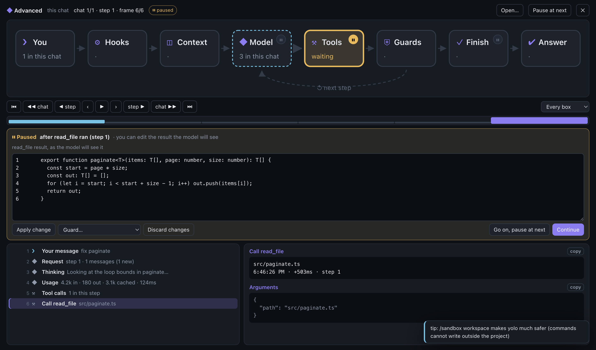

# Advanced: see and pause everything the agent does

The Advanced view shows every part of a session as boxes you can step through: your messages, hooks, context, model calls, tools, guards and the finish gate. You can also pause the run at a box and change what happens next.

In this page you will learn:

- how to open the Advanced view and move through a session, forward and back
- what each box shows, with full details
- how to pause the run at a box and change the next step
- how much is recorded, and how to limit the space it takes

<p align="center"></p>

## Open the Advanced view

**What it is.** A view that shows the whole life of a session. It does not show in normal use. You open it when you want to look inside.

**Why you would use it.** To understand why the agent did something: the exact request it sent, what a hook returned, why a guard stepped in, or why a finish was rejected.

**How to use it.**

1. Type the command in the chat (terminal or desktop):

   ```
   /advanced
   ```

   You can also open it from the Inspect menu (`≡ inspect` in the terminal, **Inspect** in the desktop app).

2. To look at an older session of this project, type:

   ```
   /advanced list
   ```

   Pick a session from the list. You can also give the start of a session id: `/advanced 20261115`.

3. To close it, press `Esc` (or type `/advanced off`).

The view works in the full-screen terminal, in the inline terminal (as text, without the diagram) and in the desktop app. `/loop` still shows the short list of the last run.

## Move through a session

The top of the view is a diagram of the agent loop. It has eight boxes:

| Box | What it shows |
|---|---|
| **You** | Your message, and anything you changed while the run was paused |
| **Hooks** | Your hook commands: what each one got as input, what it printed, how long it took and what it decided |
| **Context** | What is sent to the model: trimming, compaction, handoffs, changes to the tool list, prompt-cache breaks |
| **Model** | The exact request (system prompt, messages, tools), the thinking, the reply and the tokens it used |
| **Tools** | Each tool call: the arguments, the permission rule, your approval, the result the model saw, and the diff of an edit |
| **Guards** | The harness stepping in: loop and stagnation guards, nudges, the budget, repaired calls, the model ladder |
| **Finish** | The finish gate: the claims ledger, checks, the `verify` command, the reviewer, `Stop` hooks |
| **Answer** | The result, or why the run stopped |

A *frame* is one thing that happened, for example one tool call or one model reply. The box of the current frame lights up. An arrow shows the box it came from. The dashed arrow from **Guards** back to **Model** is the loop: the next step.

Under the diagram is a **timeline** of the whole session. Each chat is one part of it. Colours mark what went wrong: yellow for a warning (a guard, a rejected finish), red for an error (a failed call, a denied action). Click the timeline to jump there.

Below are two panels: the list of frames, and the **details** of the current frame.

**Keys in the terminal:**

| Key | What it does |
|---|---|
| `←` `→` | One frame back or forward |
| `[` `]` | One step back or forward (a step is one model call and its tools) |
| `PgUp` `PgDn` | The previous or next chat |
| `Home` `End` | The first frame, or the newest one (and follow new frames again) |
| `Tab` `Shift+Tab` | Choose a box |
| `Enter` | Jump to the next time the chosen box ran |
| `f` | Show only the chosen box (press again to show all) |
| `Space` | Play: move forward one frame at a time |
| `↑` `↓` | Scroll the details (`Shift` for 10 lines) |
| `o` | Open another session |
| `Esc` | Close the view |

With the mouse, you can click a box, a frame or the timeline, and scroll the details with the wheel. The desktop app has the same keys, plus buttons for each move.

**Example.** A run ended with "finish rejected". Open `/advanced`, choose the **Finish** box with `Tab`, and press `Enter`. The details show the rejection and its reason, for example "the record does not support your summary: no test command ran". Press `[` to go back one step and see what the model did just before.

**Limits and common problems.**

- While a run is going, the view follows the newest frame. When you step back, it stops following. Press `End` to follow again.
- Frames of a subagent show in the list with its name ("explore: Call read_file"). Their boxes are counted, but you cannot pause a subagent.
- A session recorded before this feature (or without full recording) has no exact requests, thinking or diffs. The details then say "not recorded".

## Pause the run and change the next step

**What it is.** A *pause* on a box stops the run at that box, before it goes on. While it waits, you can change what happens next.

**Why you would use it.** To test an idea without editing code: give the model a hint, fix a wrong argument, change what a tool returned, or switch a guard off and see what the model does then.

You can pause at three boxes:

| Box | Where the run stops |
|---|---|
| **Model** | Before each model call, and after its reply |
| **Tools** | Before each tool call runs, and after it ran |
| **Finish** | When the model calls `finish` |

**How to use it.**

1. Open `/advanced`.
2. Choose a box with `Tab`, then press `b`. Press `b` again to pause only **once**, and a third time to remove the pause. In the desktop app, click the small pause dot on the box.
3. Press `.` to pause at the next pause point, whatever box it is in.
4. Send your message. When the run reaches the box, it stops, and the view opens if it was closed. The box shows "waiting".
5. Change what you want (see the table below), then press `c` to continue, or `n` to continue and pause again at the next point.

**What you can change, by where the run stopped:**

| Where | Key `e` changes | Also possible |
|---|---|---|
| Before a model call | A note added before the call (the model reads it as a message from you) | `p`: the step limit, a guard on or off, which tools the model may use in this call |
| After a model reply | The reply text | `p`: the tool calls of the reply (as JSON: add, remove or change calls) |
| Before a tool call | The arguments (as JSON) | `s` skip the call (the model is told it was skipped), `d` deny it with a reason |
| After a tool call | The result the model will see | |
| At a finish | A reason to reject it (the model must fix it and finish again) | `a` accept it at once, without the checks |

`x` throws away your changes at this pause. Your changes show in the view ("your changes: arguments edited") before you continue. In the terminal, long text opens in your editor (`$VISUAL` or `$EDITOR`). In the desktop app you edit it in place and click **Apply change**.

**Example.** The agent is about to run `npm test -- --watch`, which never ends. Pause on **Tools**. When the run stops before the call, press `e` and change the arguments to `{"cmd": "npm test"}`. Press `c`. The command runs without `--watch`, and the timeline marks the frame "You changed: edited the arguments".

**Limits and common problems.**

- Safety stays on. Changed arguments go through the same permission rules, hooks and approvals as the model's own. A change that does not match the tool's schema is refused with the reason.
- A guard you switch off stays off for the rest of the session's agent, until the agent is rebuilt (for example by `/model` or a settings change).
- To interrupt a paused run, press `Ctrl+C` in the view (in the desktop app, close the view and click the stop button). The pause ends and the run stops.
- Pauses work in the terminal and the desktop app. `amness run`, `amness acp` and `amness serve` never pause.
- Every change is written to the trace as an `override` event, so you can see later what you changed.
- Pausing is tested with automated tests in both front ends. It has not been used on real tasks yet.

## Choose how much is recorded

Each session writes a trace file: `.amness/traces/<session id>.jsonl` in your project. The Advanced view reads it.

**Full recording** adds what the details need: each model request (the system prompt and tool list are written once, and each request stores only what changed since the one before), the thinking text, the diff and old content of every edit, and every hook run in full.

- Full recording is **always on while the Advanced view is open**.
- To record everything even when the view is closed, turn on **Full recording** in `/settings` (group *Advanced*), or type:

  ```
  /set fullTrace on
  ```

Traces of a project are kept under a **size limit**: 200 MB by default. When a new session starts and the folder is over the limit, Amness removes the oldest traces first. It never removes the session you are in. To change the limit, use **Trace storage limit** in `/settings`, or type:

```
/set traceLimitMb 500
```

`0` means no limit.

**Limits and common problems.**

- With full recording, a trace is larger. How much larger depends on the session. It is not measured yet.
- Secrets are masked in the trace, as before (API keys, tokens, private keys).
- Long texts are cut in the trace (for example a request message at 60,000 characters). The details then say "… more".

## For library users

The pause points are part of the harness. Pass `pause` to `createHarness` or `createCodeAgent`. It is called at each point with a `PausePoint` (`model`, `reply`, `tool`, `result` or `finish`). Return `undefined` to go on, or a `PauseEdit` with your changes. Each change is reported as an `override` event.

```ts
const agent = createCodeAgent({
  model, cwd: process.cwd(),
  pause: (p) => (p.at === "tool" && p.name === "sh" && /--watch/.test(String(p.args.cmd)) ? { args: { ...p.args, cmd: String(p.args.cmd).replace(" --watch", "") } } : undefined),
});
```

The trace helpers are exported too: `readTraceLines(file)`, `readRequests(lines)` (rebuilds each request exactly) and `pruneTraces(dir, maxBytes, keep)`.

## Next steps

- [Using the chat](usage.md): all slash commands and keys
- [Features in depth](features.md): hooks, guards, tracing and replay
- [The agent loop](agent-loop.md): what each guard does and why
- [Use it as a library](library.md): build your own harness
