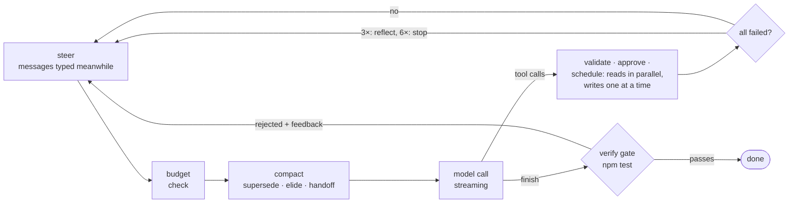

# The agent loop, caching and where the design comes from

Each turn: steer (messages you typed meanwhile) → budget check → compaction → model call → tool calls → verification gate. The details that keep long runs reliable:

- **Scheduling.** Read-only and subagent calls in one turn run concurrently (up to 5); anything that can change state runs alone, in the order issued. Mark your own tools `readOnly` or `parallel` to opt in.
- **Compaction in stages, cheapest first.** Observations are condensed as they arrive (terminal codes and progress redraws stripped, repeated lines collapsed, long output cut to head and tail plus its error lines). Older output that is repeated or **expired** (a read of a file that was edited afterwards) is dropped, then old tool output is elided, and only on very long runs does the model write a handoff note and continue in a fresh context. Elision cuts well below the budget in one go, so the provider's prompt-cache prefix stays valid between cuts. `/loop` shows how much was trimmed.
- **Post-edit check.** `/check <cmd>` (headless `--check`, library `check`) runs a fast command such as a typecheck after every edit. Only a failure is shown to the model, appended to the edit result, so a mistake is caught one step after it happens instead of at the end.
- **Guards.** Repeat-call detection (the same call, normalised, with nothing edited in between; re-running tests after an edit is fine), cycle detection (2 to 4 different calls repeating three times, such as an edit flipped back and forth around a test run), a nudge when the model announces an action instead of taking it, a wrap-up warning three steps before the step cap, and no-progress detection (a reflection prompt after 3 all-failing turns, a clean stop after 6).
- **Stagnation is judged from objective signals.** A loop that keeps acting while nothing measurable improves gets a structured reflection after 8 such turns and a clean stop after 12. "Improves" means: the failing-test, error or lint count reaches a new low (parsed from Jest, pytest, Go, Cargo, the Node runner, `tsc`, `eslint`...), a file is edited for the first time, an edit adds a change that is not the undo of an earlier one, or something new is read (capped). The model's own confidence counts for nothing. Tune with `stagnationTurns`; `off: ["stagnation"]` switches it off for ablations.
- **Claims are checked against a record.** The harness records what really happened (files edited, commands run and their exit codes) and compares the `finish` summary with it: "all tests pass" needs a passing test run *after the last edit*, "build is clean" needs a successful build or typecheck, and a file named as changed must have been edited. A mismatch is rejected with the specifics (at most twice, so it can never deadlock). Accepted runs end with an audit line: files changed, whether tests passed after the final edit, test files touched when the task did not mention tests. Agents that judge their own work accept plausible progress as real progress ([When Do Agent Loops Mistake Stagnation for Progress?](https://arxiv.org/abs/2607.25152)); this is the cheap external check.
- **Independent reviewer (opt-in, `/reviewer on` or `--review`).** Builders overpraise their own work, and a separate judge is easier to make sceptical than a builder is to make self-critical ([Anthropic's long-running harness write-up](https://www.anthropic.com/engineering/harness-design-long-running-apps)). Before a task-like message, a fresh context writes 3 to 7 testable acceptance criteria that the builder sees; before a `finish` is accepted (after the ledger and your `verify` command), a read-only reviewer that can run only the project's own test, build and lint commands checks the diff against them. Findings go back to the builder; after two rounds the work is accepted and flagged, and an unusable verdict never blocks. It costs roughly two to four extra model calls per task and can use a different model (`review: { model }`), so it is off by default; measure it with `amness eval --variants full,full+review`.
- **Done means verified.** `finish` passes through your `verify` gate (tests, build) and is rejected with feedback until it holds.

### Prompt cache and memory

Cached input costs a fraction of fresh input, so the loop is built to keep the request prefix identical from turn to turn:

- **Append-only by default.** Old messages are rewritten only when the window needs it, and then in one cut well below the budget (so a rewrite happens every several turns, not every turn). New information (steering messages, relevant memory notes) always goes at the *end*.
- **Stable request shape.** Tool definitions are sorted by name, the memory index is injected once per conversation, and OpenAI requests carry a stable per-project `prompt_cache_key` with 24-hour cache retention (dropped automatically for models that refuse it). Claude requests use automatic caching on an append-only transcript.
- **Keep-alive (opt-in).** Claude drops a cached prefix after about 5 idle minutes. `/keepwarm on` re-sends the conversation with a 16-token output cap about every 4.5 minutes while you are away (at most 3 times per break), which costs a cache read instead of a cold re-read. It is off by default because it spends tokens while you are not looking, and it only applies to Claude (OpenAI requests already ask for 24-hour retention).
- **You can see it.** `/loop` marks every turn where the prefix changed ("cache break: earlier history was rewritten at message 14", "the tool list changed") and counts them; the usage panel shows the cache hit rate; `amness eval` reports it per variant, so you can measure what a change does to cost.

### Where these choices come from

Recent work on coding-agent loops points the same way, and the loop follows it where it can be done without training a model:

- [An Empirical Study of Harness Design for Coding Agents](https://arxiv.org/abs/2609.20804) (2026): cheap rule-based elision before any LLM summarisation gave the lowest cost; a recall tool for elided content was almost never used, so there isn't one; stuck detection and lightweight post-edit checks are cheap ways to stop wasted turns.
- [AgentDiet](https://arxiv.org/abs/2509.23586) (trajectory reduction): removing useless, redundant and *expired* information cut input tokens 40-60% with unchanged results. This is the source of the expired-read and repeated-call rules.
- [CoACT](https://arxiv.org/abs/2607.02911) and [SWE-Pruner](https://arxiv.org/abs/2601.16746): reads dominate token use, and compression must preserve what the next action needs, and leave earlier messages untouched to keep the cache valid. Amness uses rules for this; the papers use trained compressors, which would add a dependency.
- [Don't Break the Cache](https://arxiv.org/abs/2601.06007) (prompt caching for long-horizon agents): caching cut API cost by 41-80% across OpenAI, Anthropic and Google, but naive full-context caching can hurt; put dynamic content at the end, avoid dynamic tool lists, keep dynamic tool results out of the cached prefix. [Keeping the Cache Warm Pays](https://arxiv.org/abs/2607.19214) motivates the longer OpenAI retention and the opt-in Claude keep-alive.
- Memory: [Infini Memory](https://arxiv.org/abs/2606.10677) (plain-text topic documents, lexical retrieval, merge/split maintenance, recency resolves contradictions; its structural maintenance mattered most in its ablations), [REALM](https://arxiv.org/abs/2609.16053) (retrieval feeds back into how memory is organised, which is why Amness records use and ranks by it) and the strategic-forgetting work ([SF-AMS](https://arxiv.org/abs/2607.22562), [FSFM](https://arxiv.org/abs/2604.20300)). Amness implements these with plain files: lexical plus optional embedding retrieval, merge maintenance (`/memory consolidate`), a light note graph with use-driven links, outcome-based ranking and reversible forgetting. "Learning" here means simple statistics (wins and losses per note), not a trained model, and there is no graph database.
- A [source-code study of eleven coding agents](https://arxiv.org/html/2609.00006v1): read-only tools run concurrently, mutating tools one at a time.

The percentages above are the papers' results on their own benchmarks, not measurements of Amness; use the eval runner (`evaluate`) with the guards switched on and off to measure them on your tasks.

## Budget awareness and runs that never close

A task like "read the code and explain it" can keep reading until the token cap ends the run with nothing to show. Three things address it:

- **The model sees its budget** (after [BATS, arXiv 2511.17006](https://arxiv.org/abs/2511.17006), where a plain budget tracker made agents spend tool calls better; the paper tests web-search agents, not coding agents). At 50% of the cap a note says to stop broad exploration, at 75% and 90% to produce the result. The notes are appended at the end of the conversation, so the provider's cached prefix is untouched.
- **A final report instead of a bare stop.** When the next step plus a summary would no longer fit under the cap (or the cap is hit), the harness makes one last call without tools asking what was found, the state of the work and what remains, and returns that text. The run still counts as not finished.
- **Exploration check.** After 12 turns in a row that only read, the model is told to answer (if the task is a question) or start (if it is a change), or to name exactly what is still missing; it repeats after another 12.

Also, the token cap now counts cached input at a tenth of its size (what it costs), because a long session re-reads its whole history every turn and was being charged in full. The displayed token count is unchanged. All of this is under the `wrapup` guard. Tested with scripted models; whether it reduces exhausted runs on real tasks is not measured.

**Subagents get a slice, not the whole budget.** The read-only explorer may use at most 20% of what is left (and 80k tokens), custom agents 30% (150k), and everything they spend still counts against the main budget. Inside its slice a subagent gets the same budget notes and final report, so an explorer that runs out returns what it found instead of an error. The explorer is told it has about 12 tool calls and to answer in under 300 words. A `task` call with an agent name that does not exist (for example `explorer`) now uses the read-only explorer and says so, instead of failing and costing a round trip.
