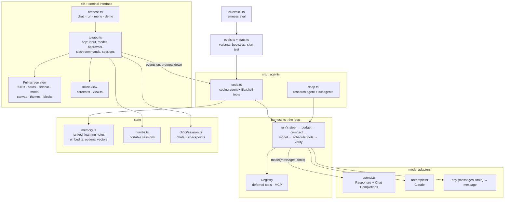

# Architecture

Amness has three layers: a terminal interface, an agent, and a loop called the harness. This page shows how they connect and which file does what.

In this page you will learn:

- how the layers depend on each other
- which file in `src/` and `cli/` you should open for a given job
- how the full-screen interface draws a frame

## Find your way around the layers

**What it is.** The layers depend on each other in one direction only. The **UI** (`cli/`) drives the **agent** (`src/code.ts`, `src/deep.ts`). The agent is built on the **harness** (`src/harness.ts`). Models are plain functions that you pass in from outside.

**Why it matters.** The harness and the agents do not import the UI. So everything in `src/` works as a library. See [Use it as a library](library.md).

```
  you (keyboard, mouse)
        |
  +-----v--------------------------------------------+
  | UI layer          cli/                           |
  |   amness.ts  ->  tui/app.ts  ->  full.ts / screen.ts
  +-----+--------------------------------------------+
        |  prompts go down, events come up
  +-----v--------------------------------------------+
  | Agent layer       src/code.ts   src/deep.ts      |
  |   coding agent, tools, subagents, memory         |
  +-----+--------------------------------------------+
        |
  +-----v--------------------------------------------+
  | Harness layer     src/harness.ts                 |
  |   run(): steer, budget, compact, model, tools,   |
  |   verify. Guards: ledger.ts, progress.ts         |
  +-----+--------------------------------------------+
        |  model(messages, tools) -> message
  +-----v--------------------------------------------+
  | Model adapters    src/openai.ts  src/anthropic.ts|
  |   or any function with the same shape            |
  +--------------------------------------------------+
```

The same picture with more detail:



**Limits.** The diagrams show the main paths only. Many small files in `src/` (for example `permissions.ts`, `hooks.ts`, `sandbox.ts`) are called by the agent layer and are not drawn.

The runtime has no required packages. The Claude adapter needs the optional package `@anthropic-ai/sdk`.

## Find which file does what

The table lists every file in `src/` and `cli/`. The text comes from the first comment lines of each file. Open the file for details.

### `src/` : agent, harness and helpers

| File | What it does |
|---|---|
| `src/harness.ts` | The agent loop and its guards. Also `Registry` (the tools), `Budget`, `extract()` and the compaction functions. |
| `src/code.ts` | The coding agent: file and shell tools, the `task` tool for subagents, todos, plan mode, permission modes. |
| `src/deep.ts` | The research agent with subagents and an in-memory file system. |
| `src/index.ts` | The library entry point. It re-exports the other modules. |
| `src/openai.ts` | Adapter for OpenAI and OpenAI-compatible servers (Responses and Chat Completions APIs). |
| `src/anthropic.ts` | Adapter for Claude through the official Anthropic SDK. |
| `src/route.ts` | Roles that use different models (explore, compact, review) and a fallback chain when a provider is overloaded. |
| `src/router.ts` | Per-step routing between a strong and a cheap model, with the prompt-cache cost in the decision. |
| `src/ratelimit.ts` | A shared gate that keeps requests under the provider's per-minute limits. See [Budgets](budgets.md#rate-limits-requests-and-tokens-per-minute). |
| `src/ledger.ts` | The claims ledger: records edits and commands and checks the final summary. |
| `src/progress.ts` | Stagnation detection from objective signals (failing-test counts, new edits). |
| `src/review.ts` | The independent reviewer: acceptance criteria before the work, a check before it is accepted. |
| `src/approver.ts` | An optional second opinion on risky calls, from a cheaper model. It can approve but not refuse. |
| `src/permissions.ts` | Permission rules and the safety floor that holds in every mode. |
| `src/hooks.ts` | Lifecycle hooks: your commands at fixed points of the loop. |
| `src/plugins.ts` | Plugins: harness behaviour written as code (tools, hooks, eval tasks, variants). |
| `src/sandbox.ts` | OS-level sandbox for shell commands (Seatbelt on macOS, Bubblewrap on Linux). |
| `src/snapshot.ts` | Reversible shell commands: records the working tree as a git tree object before a command runs. |
| `src/secrets.ts` | Masks secrets in tool output before the model sees it. |
| `src/shell.ts` | Chooses which shell runs commands (a POSIX shell, including on Windows). |
| `src/procs.ts` | Background processes: start a server, read its output later, stop it. |
| `src/schema.ts` | A small JSON-schema checker and a tolerant JSON parser for model output. |
| `src/patch.ts` | Multi-file patches, applied all or nothing. |
| `src/diff.ts` | A line diff that makes unified hunks. |
| `src/lsp.ts` | Language-server diagnostics after edits. |
| `src/codeindex.ts` | A structural index of the repository: symbols, imports and where symbols are used. |
| `src/guidance.ts` | Loads project instruction files (`AGENTS.md`, with `CLAUDE.md` and `GEMINI.md` as fallbacks). |
| `src/skills.ts` | Skills: folders with a `SKILL.md` that the model loads when needed. |
| `src/agents.ts` | Custom subagents defined as markdown files. |
| `src/memory.ts` | Memory: ranked notes, merging, a light graph, learning from outcomes, an archive. |
| `src/embed.ts` | Optional embeddings for memory search. |
| `src/bundle.ts` | Portable session bundles: handoff note, memory and changed files. |
| `src/dynamic.ts` | Tools the agent defines as shell commands, and the live tool registry (MCP). |
| `src/images.ts` | Reads an image file for models that accept images. |
| `src/web.ts` | Web search and URL fetch tools. |
| `src/worktree.ts` | Git worktrees: an isolated copy of the repository for an agent. |
| `src/parallel.ts` | Several agents at once, each in its own worktree (best-of-N and parts). |
| `src/gitflow.ts` | Review and pull-request helpers around git and the GitHub CLI. |
| `src/live.ts` | Live view of a run in the browser, on `127.0.0.1` only. |
| `src/acp.ts` | Agent Client Protocol server, so an editor can host Amness. |
| `src/schedule.ts` | Recurring headless runs through cron lines. |
| `src/trace.ts` | Tracing: every loop event goes to a local JSONL file, and optionally to an OpenTelemetry collector. |
| `src/replay.ts` | Replays a recorded trace through the current harness without a model or tools. |
| `src/mining.ts` | Failure mining: groups failures from traces and turns one into an eval task. |
| `src/evals.ts` | The eval runner: variants and ablations. |
| `src/evalcases.ts` | Small built-in eval tasks and a loader for your own cases. |
| `src/hardcases.ts` | Harder built-in eval tasks. |
| `src/suites.ts` | Public-benchmark style suites (SWE-bench format) as eval cases. |
| `src/stats.ts` | Small statistics for comparing variants. Tasks are the unit of analysis. |
| `src/profiles.ts` | Harness profiles: settings that depend on the model. |
| `src/tune.ts` | `amness tune`: bounded changes to the harness settings, kept only if they hold on unseen tasks. |

### `cli/` : the command line and the terminal interface

| File | What it does |
|---|---|
| `cli/amness.ts` | The entry point: chat (default), headless `run`, the classic menu, `demo`. It picks the full-screen or inline view. |
| `cli/headless.ts` | Non-interactive mode for CI, scripts and containers: `amness run`. |
| `cli/config.ts` | Reads and writes the configuration file. |
| `cli/model.ts` | Builds the model for a configuration. All models for one endpoint and key share one rate-limit gate. |
| `cli/detect.ts` | Guesses the command that proves the project works (the finish gate). |
| `cli/state.ts` | Small remembered state: last project, verify command per project, task history. |
| `cli/format.ts` | One readable trace line per harness event. |
| `cli/ui.ts` | A small terminal UI without dependencies: colours, boxes, menus, prompts, spinner. |
| `cli/demo.ts` | The guided demo: a scripted model that makes mistakes so every guard fires. No API key. |
| `cli/evalcli.ts` | `amness eval`: compare harness variants with statistics. |
| `cli/schedulecli.ts` | `amness schedule`: recurring headless runs through cron. |
| `cli/acpcli.ts` | `amness acp`: serve the Agent Client Protocol on stdin and stdout. |

### `cli/tui/` : the chat interface

| File | What it does |
|---|---|
| `cli/tui/app.ts` | The `App`: one persistent conversation with input box, streaming output, approvals and slash commands. |
| `cli/tui/commands.ts` | The slash commands. |
| `cli/tui/custom.ts` | Your own slash commands, from markdown files. |
| `cli/tui/complete.ts` | Autocomplete for `/commands` and `@file` mentions. |
| `cli/tui/mentions.ts` | Turns `@path` mentions into attached file contents. |
| `cli/tui/editor.ts` | The multi-line input editor, as a state machine with no terminal input or output. |
| `cli/tui/keys.ts` | Turns raw terminal input into key events (keys, mouse, paste). |
| `cli/tui/session.ts` | Saves conversations per project and handles undo and rewind of file changes. |
| `cli/tui/blocks.ts` | The retained transcript: structured blocks that the full-screen view draws from. |
| `cli/tui/full.ts` | The full-screen view: header, transcript, sidebar, input, modals, toasts and mouse handling. |
| `cli/tui/cards.ts` | Card renderers: each transcript block becomes rows of styled cells. |
| `cli/tui/sidebar.ts` | The right-hand panel with the state of the session. |
| `cli/tui/modal.ts` | Modal dialogs for the full-screen view. |
| `cli/tui/overlays.ts` | Pieces drawn in place of the input box in the inline view: choices, pickers, help. |
| `cli/tui/canvas.ts` | A grid of character cells. `flush()` writes only the cells that changed. |
| `cli/tui/ansi.ts` | Converts between ANSI strings and styled cells. |
| `cli/tui/rich.ts` | Row-building helpers and the markdown style for the full-screen view. |
| `cli/tui/themes.ts` | The colour themes for the full-screen view. |
| `cli/tui/theme.ts` | Colour support for the inline view (truecolor, 256, 16, none). |
| `cli/tui/brand.ts` | Provider and model symbols, and the logo. |
| `cli/tui/diffview.ts` | The diff viewer: line numbers, tints, syntax colours, split layout. |
| `cli/tui/markdown.ts` | Converts markdown to ANSI lines for assistant messages. |
| `cli/tui/text.ts` | Text basics: strip ANSI, display width, wrapping. |
| `cli/tui/screen.ts` | The inline renderer: finished output goes to normal scrollback, and a small live region at the bottom is redrawn. |
| `cli/tui/view.ts` | Pure rendering helpers for the chat UI. They return lines and never touch the terminal. |
| `cli/tui/pager.ts` | The full-transcript viewer (Ctrl+O). |
| `cli/tui/clipboard.ts` | Copies text to your clipboard (OSC 52 and the platform tool). |
| `cli/tui/pricing.ts` | Rough price and context-window tables for the footer. They are estimates. |
| `cli/tui/tokens.ts` | The "where did my tokens go" report. |

## Understand how the full-screen interface draws

**What it is.** The full-screen view draws the whole screen from one grid of cells.

**How it works.**

1. Agent events reach `App.onEvent()` in `cli/tui/app.ts`. They are written into the block store (`BlockStore` in `cli/tui/blocks.ts`).
2. Each block is drawn into rows of styled cells (`cli/tui/cards.ts`). `cli/tui/full.ts` keeps the result in a cache and reuses it while the block's signature is the same.
3. `draw()` in `cli/tui/full.ts` places the header, transcript, sidebar, status line, input and footer on a `Canvas`. The sidebar shows only when the terminal is at least 104 columns wide.
4. `Canvas.flush()` in `cli/tui/canvas.ts` returns only the cells that changed since the last frame. `draw()` wraps that text in synchronized-output markers (`ESC[?2026h` and `ESC[?2026l`), so you do not see a half-drawn frame.
5. While the view runs, it turns on the alternate screen, mouse reporting (SGR 1006) and bracketed paste. It turns them off on exit. Copying uses OSC 52.
6. When you resize the terminal, `invalidate()` clears the cache and forces a full repaint.

The inline renderer (`cli/tui/screen.ts`) uses the same `App` and the same agent events. Both views show the same behaviour.

**Limits and common problems.**

- Synchronized output and OSC 52 depend on your terminal. If your terminal ignores them, you may see flicker or copying may not reach your clipboard. Not verified on every terminal.
- Tests for the canvas, keys and full-screen view are in `test/tui-canvas.test.ts`, `test/tui-keys.test.ts` and `test/tui-full.test.ts`.

## Next steps

- [The agent loop](agent-loop.md): follow one turn through these files.
- [Use it as a library](library.md): use `src/` without the UI.
- [Plugins](plugins.md): add behaviour as code.
- [Development and limitations](development.md): run the tests.
