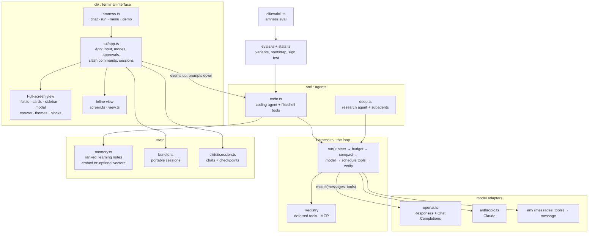

# Architecture

Three layers with one-way dependencies: the **UI** (`cli/`) drives the **agent** (`src/code.ts`, `src/deep.ts`) which is built on the **harness** (`src/harness.ts`); models are plain functions injected from outside. The harness and the agents have no dependency on the UI, so everything in `src/` is usable as a library.

| Path | Role |
|---|---|
| `cli/amness.ts` | entry point: chat (default), headless `run`, classic `menu`, `demo`; chooses full-screen or inline |
| `cli/tui/app.ts` | the `App`: key handling, permission modes, approvals, slash commands, queued steering, undo/rewind |
| `cli/tui/full.ts` + `cards.ts`, `sidebar.ts`, `modal.ts`, `diffview.ts` | full-screen view: layout, transcript cards, sidebar, modals, diff renderer |
| `cli/tui/blocks.ts` | retained transcript model (user, assistant, tool, thinking, notice blocks) that the full-screen view renders from |
| `cli/tui/canvas.ts`, `ansi.ts`, `themes.ts`, `rich.ts` | cell grid with diffing flush, ANSI parsing, the seven themes, shared styling helpers |
| `cli/tui/screen.ts`, `view.ts` | the inline renderer (live region plus native scrollback) |
| `src/harness.ts` | the agent loop and guards (see below); `Registry`, `Budget`, `extract()` |
| `src/code.ts`, `src/deep.ts` | coding agent (file and shell tools, subagent `task`, todos, plan mode) and research agent |
| `src/openai.ts`, `src/anthropic.ts` | model adapters; a model is just `(messages, tools, opts) => Promise<Message>` |
| `src/memory.ts`, `src/embed.ts` | memory: ranking, merging, graph, outcome learning, archive; optional embeddings |
| `src/bundle.ts`, `src/dynamic.ts` | portable session bundles; live tool registry and MCP |
| `src/evals.ts`, `src/stats.ts`, `src/evalcases.ts`, `cli/evalcli.ts` | the eval runner: variants and ablations, task-level statistics, built-in tasks, `amness eval` |
| `cli/tui/clipboard.ts` | clipboard (OSC 52 plus the platform tool) |
| `src/live.ts` | browser live view (`127.0.0.1` only) |

**How the full-screen UI draws.** Agent events are written into the block store; each block renders to rows of styled cells (cached by content signature); the view lays out header, transcript, sidebar, input and footer onto a `Canvas`, and `Canvas.flush()` writes only the cells that changed, wrapped in synchronized-output markers so frames never tear. Mouse (SGR 1006), bracketed paste and OSC 52 clipboard are enabled while it runs and restored on exit. The inline renderer shares the same `App` and agent events, so both interfaces behave identically.

The runtime has no dependencies.
