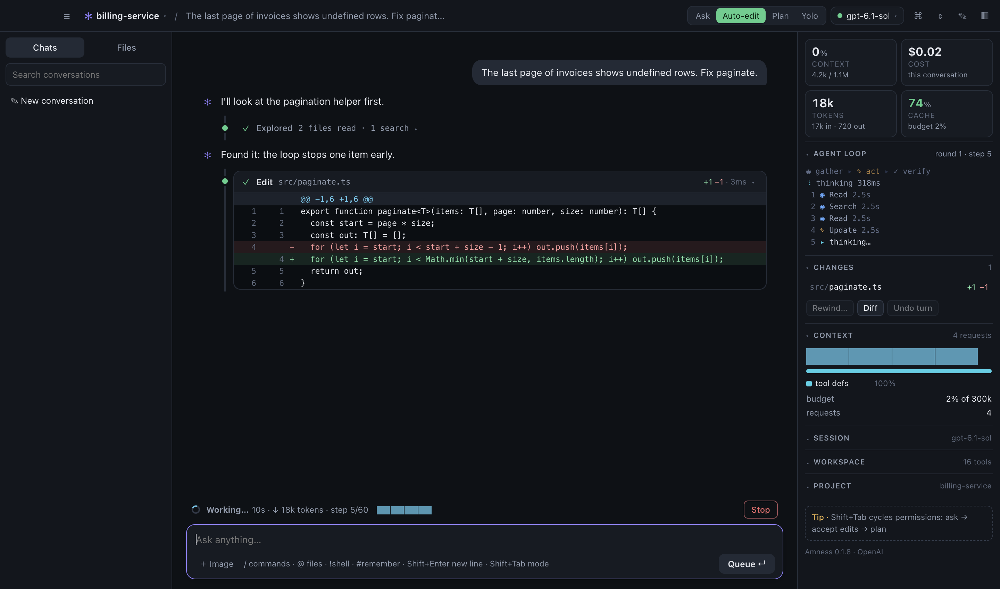

# The desktop app

Amness also runs as a desktop app. It is the same agent as the terminal app, with the same settings, API keys, conversations, permissions and safety rules. Only the window is different.



## Start it

```bash
npm install -g amness            # installs both commands: amness and amness-desktop
cd ~/your-project && amness-desktop
```

You can also give a folder (`amness-desktop ~/code/api`) or use `amness desktop`. When you start it from a dock or a menu, it opens your last project.

The first time, if no API key is set, the app asks for one. Keys are saved in the same place as for the terminal app (your system keychain when there is one).

| Option | What it does |
|---|---|
| `--browser` | Opens the app in your browser instead of its own window. |
| `--no-window` | Starts only the local server and prints its address. |
| `--port n` | Uses this port instead of a free one. |

## What is in the window

The window runs the terminal app itself (the same `App`), so everything the terminal can do, the window can do too. When a feature is added to the terminal app, the window has it as well.

- **Every command.** Type `/` in the message box for the same commands and suggestions as in the terminal, with their arguments (`/mode p` suggests `plan`). `!cmd` runs a shell command, `#note` saves a memory. `Ctrl/⌘ K` opens a searchable list of all commands. What a command prints (for example `/status`, `/loop`, `/tokens`) appears in the conversation in the terminal's colours, with a Copy button.
- **Every dialog.** Approvals, pickers (`/model`, `/resume`, `/theme`…), questions and help open as windows: the same dialogs as in the terminal. Press `1`–`9` to choose; in a list, type to search. If you say no to an approval, Amness asks what to do instead.
- **Chat.** Replies stream in with formatted text, tables and code blocks (with Copy).
- **Steps: what happens now is open, the rest folds.** While Amness works, its steps sit on a timeline. The step happening now is open (an edit shows its diff, a command its output); earlier steps fold to one line each. Reads and searches in a row are one "Explored" step. When the turn ends, all of its work folds into one line, for example "Worked 1m 10s · 8 steps · read 5 · edited 2 · ran 3", with the changed files as chips you can click. The answer stays below it, in full. Open anything by clicking it; what you open or close stays that way. `Ctrl/⌘ E` opens everything at once.
- **Subagents.** Subagents that run side by side share one card, with a row each (task, current step, steps, time). A working agent shows its newest steps; a finished one folds to one line. Click a row for all its steps and its answer.
- **Thinking.** The model's thinking appears in the conversation where it happens. It is open while it forms, so you can read along. When the next step or the answer starts, it folds to one line ("Thought for 3s") with a short preview. Click it to read it again. In a finished turn, the thinking lines are inside the folded "Worked" line, in order.
- **Live status.** While Amness works: what it is doing, the time, the tokens so far with a small chart, the step number, and any messages waiting in the queue. `Esc` or **Stop** interrupts.
- **Workspace panel** (right, `Ctrl/⌘ J`). Four tiles at the top show context, cost, tokens and cache. Below them, sections you can fold (your choice is remembered) show the same information as the terminal sidebar: the agent loop of the current or last run (gather ▸ act ▸ verify, each step with its time; click a step to open it), the session (model, API, effort, branch, mode, sandbox), context use with a chart per request and what fills it, usage (tokens, cache, reasoning, budget, cost, last turn), todos, changed files (with **Rewind…**, **Diff** and **Undo last turn**), background processes, skills, plugin status, tools, MCP servers and memory notes, and a tip.
- **Sidebar** (left, `Ctrl/⌘ B`). **Chats** lists your conversations, with search and a preview. **Files** shows the project tree; files changed in this conversation are marked.
- **File view.** Click a file, or a path in a reply such as `src/app.ts:12`, to open it next to the chat. Lines Amness changed are highlighted, and the view updates when Amness edits the file. **@ Mention** adds the file to your message; **Open in editor** uses `$VISUAL` or `$EDITOR` (for example `code`), or your system's default app.
- **Model and provider.** Click the model name for the model, reasoning effort, providers and API keys, models for roles, budget, token use and cache. These open the same dialogs as `/model`, `/effort`, `/connect` and `/models`.
- **Projects.** Click the project name to open another folder or a recent project, or for hooks, permissions, plugins, agents and `/init`.
- **Small windows.** Below 1280 pixels wide the workspace panel opens over the chat as a drawer; below 1000 pixels the sidebar does too. Click outside a drawer to close it. Below 1150 pixels the file view covers the chat while it is open.
- **Notifications.** When a turn takes more than 20 seconds and the window is in the background, you get a desktop notification.

## Preferences

Click ⚙ in the top bar, or press `⌘,` (macOS) or `Ctrl+,`. Changes apply at once and are saved in `~/.amness/config.json`, the same file as the terminal app's settings, so they survive restarts.

| Section | What you can set |
|---|---|
| Appearance | Theme (System, Dark, Light), accent colour, interface size, chat text size, code font, density (Comfortable, Compact), reduce motion |
| Chat | The mode a new window starts in, send with Enter or ⌘/Ctrl+Enter, fold finished turns, open the current step by itself, notifications |
| Model | Provider and API keys, model, reasoning effort, budget per turn, fallback model, models for the explorer, compaction, reviewer and cheap steps, router, wire API |
| Safety & quality | Sandbox, verify command, check after each edit, language-server errors, independent reviewer, approval reviewer |
| Advanced | Shell, loop strategy, keep the cache warm, plan cache |
| About | Version, project folder |

Agent settings work by running the same command you would type in the terminal (for example `/sandbox workspace`), so both apps behave the same.

The app has its own icon (the Amness mark) in the dock, the taskbar and the window. To change it, edit `cli/desktop/assets/icon.svg` and run `npm run desktop:icons`.

| Shortcut | Action |
|---|---|
| `Ctrl/⌘ K` | All commands |
| `Ctrl/⌘ N` | New conversation |
| `Ctrl/⌘ O` | Open a project folder |
| `Ctrl/⌘ P` | Go to a file |
| `Ctrl/⌘ F` | Find in the conversation |
| `Ctrl/⌘ E` | Expand or collapse all tool output and thinking |
| `Ctrl/⌘ B`, `Ctrl/⌘ J` | Show or hide the sidebar, the workspace panel |
| `Shift+Tab` | Next permission mode |
| `Ctrl/⌘ ,` | Preferences |

## How it works, and why it is safe

`amness-desktop` starts a small server on your computer (address `127.0.0.1`, which other computers cannot reach) and opens an Electron window that shows it. The agent runs in Node: it is the terminal app's own `App`, started without a terminal (`ui: "remote"`). A small bridge (`cli/desktop/bridge.ts`) sends the window what the terminal would draw: the conversation, the side panel's data (`cli/tui/panel.ts`, shared by both), the App's dialogs and what commands print. It sends the window's actions back to the same App methods the terminal uses.

To check the window the way a person uses it (typing, clicking, dialogs, panels), run `npm run test:desktop-ui`. It needs a screen, so it is not part of `npm test`.

- Every request must carry a random key that is made new at each start. Other programs and websites cannot use your agent.
- The page runs in Electron's sandbox, with no access to Node or to your files. It can only ask for a folder picker.
- Text from the model and from files is always shown as text, never run as code.
- Links open in your normal browser, not in the app.
- Project hooks and permission rules are only used if you trusted that exact version of them in the terminal app (`amness`).

## Size

Electron comes with the package, so `npm install -g amness` downloads about 100 MB more than before (about 300 MB unpacked). If the Electron download fails, `amness-desktop` opens the same app in a Chrome or Edge app window, or in your browser.
