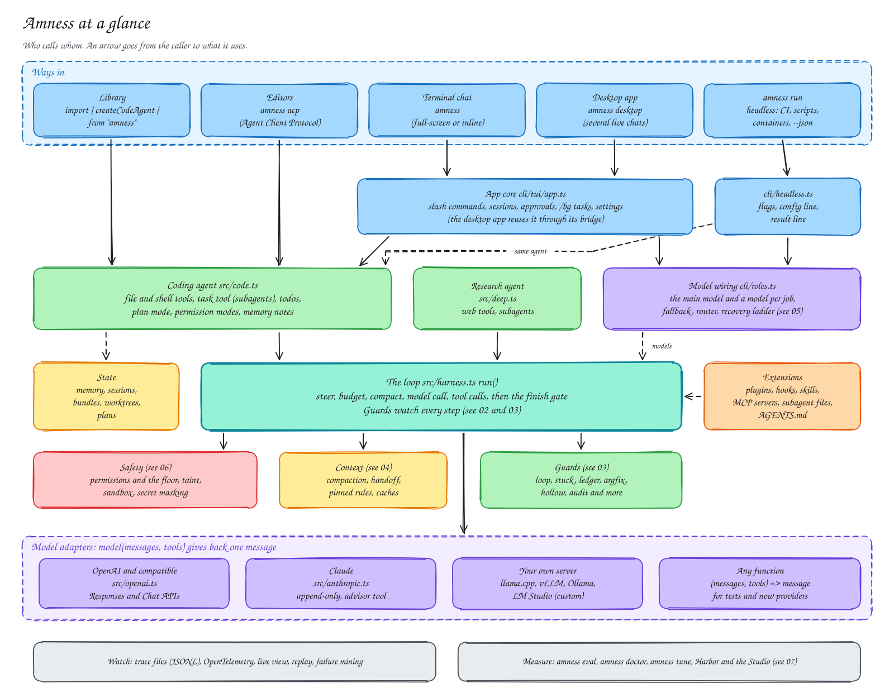

# Pictures of the harness

Eight drawings show every part of Amness: who calls whom, one turn of the loop, the guards, context, models, safety, measurement and parallel work.

In this page you will learn:

- how the parts of Amness fit together, one picture per topic
- which page explains each picture in words
- how to change a picture and draw it again

Each picture is an Excalidraw drawing. *Excalidraw* is a free drawing tool with a hand-drawn style. GitHub shows the `.svg` file here. The `.excalidraw` file next to it opens in [excalidraw.com](https://excalidraw.com) or in the Excalidraw extension for VS Code, so you can move things and add notes.

## See the whole system

Who calls whom: the ways in (library, editors, terminal, desktop, `amness run`), the agents, the loop, and the model adapters. An arrow goes from the caller to what it uses.



Read more: [Architecture](architecture.md).

## Follow one turn of the loop

What `run()` in `src/harness.ts` does in one step: steer, budget, compact, model call. Then either each tool call goes through its checks, or a `finish` call goes through the finish gate. The order of the checks is the order in the code.


Read more: [The agent loop](agent-loop.md#see-how-one-turn-works).

## Find where each guard acts

A *guard* is a rule in the loop that stops a known mistake. The picture puts each of the 20 guards in the phase where it acts. The colour says whether it is on by default.


Read more: [Guards](agent-loop.md#guards).

## See how the context stays small enough

The *context window* is the most text a model can read in one request. The picture shows the stages Amness uses to stay inside it, cheapest first, and the caches.


Read more: [Keeping inside a context window](agent-loop.md#keeping-inside-a-context-window).

## Give jobs to other models

Each job (explore, compact, review and more) can use another model, on any provider or saved server. The lower part shows what happens when a model is too weak: the recovery ladder, takeover, and `amness doctor`.


Read more: [Models per job and a fallback](features.md#models-per-job-and-a-fallback), [Providers and models](providers.md).

## Check what protects you

The layers a tool call passes through, in order, and what happens around it: folder trust, the sandbox, snapshots, secret masking and untrusted content.


Read more: [Safety and privacy](safety.md).

## Measure a change

Small checks on your machine with `amness eval`, and long Terminal-Bench campaigns on a server with [Amness Evaluation Studio](https://github.com/amirsdream/amness-eval-studio). What the runs find goes back into Amness as fixes, and the next campaign checks them.


Read more: [Evaluating the harness](evaluation.md), [Run Amness on Terminal-Bench](../bench/harbor/README.md).

## Work on several things at once

Background tasks, live chats in the desktop app, background runs from scripts, and the ways one run can use several agents.


Read more: [Work on several things at once](features.md#work-on-several-things-at-once-background-tasks-and-live-chats), [Several agents at once](features.md#several-agents-at-once-best-of-n-and-parallel-parts).

## Change a picture

The pictures are drawn from data, so they stay tidy and match each other.

1. Change the boxes, arrows or texts in `scripts/diagrams/specs.mjs`. Positions are in pixels.
2. Draw them again:

   ```bash
   node scripts/diagrams/render.mjs
   ```

   To draw only one picture, add its name, for example `node scripts/diagrams/render.mjs 02-one-turn`.
3. Open the `.svg` file in a browser to check it. Then commit both files of each picture.

You can also edit a `.excalidraw` file in Excalidraw directly. Then export it as SVG with the same name. The next run of `render.mjs` overwrites hand edits, so put lasting changes in `specs.mjs`.

**Limits.**

- The pictures show the main paths, not every file. When the code changes, check that the matching picture still says the same thing.
- The SVG files embed the Latin part of Excalifont (SIL Open Font License), Excalidraw's own font. Characters outside it use a font on your computer.
- GitHub shows the pictures on a white background, also in dark mode.

## Next steps

- [Architecture](architecture.md): which file does what.
- [The agent loop](agent-loop.md): the loop and the guards in words.
- [Evaluating the harness](evaluation.md): measure a guard on your own tasks.
