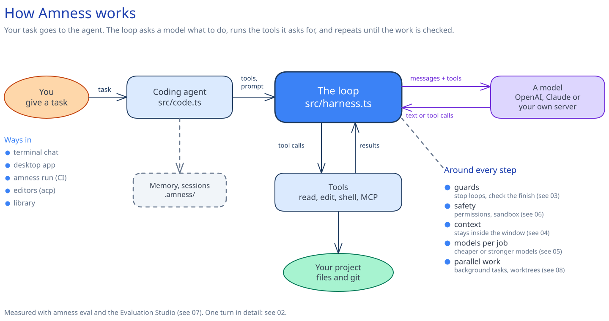
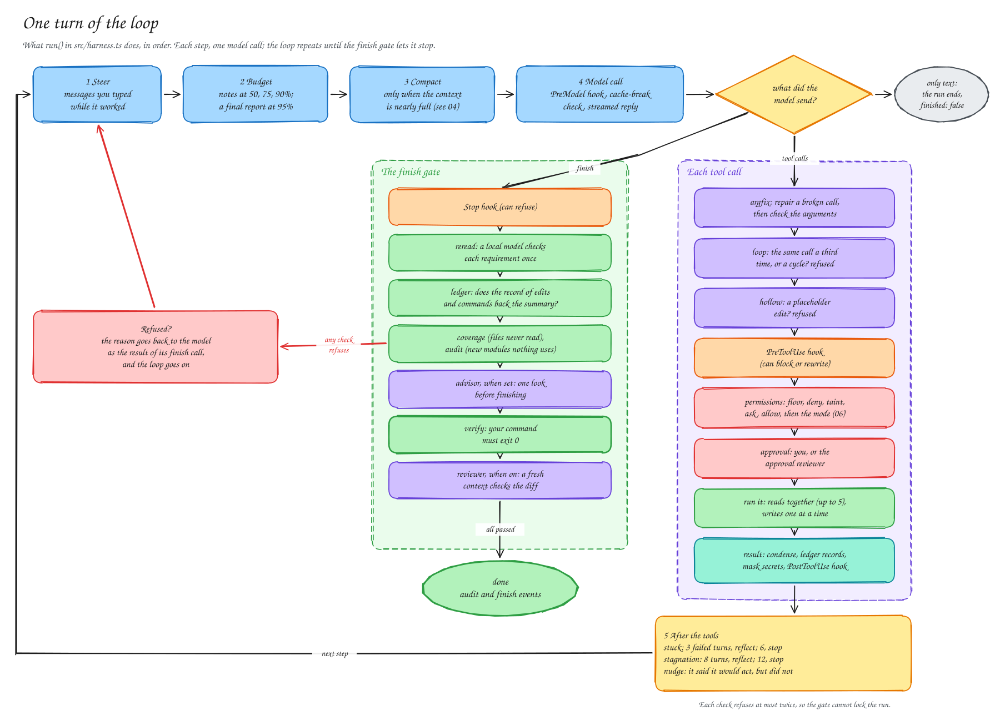
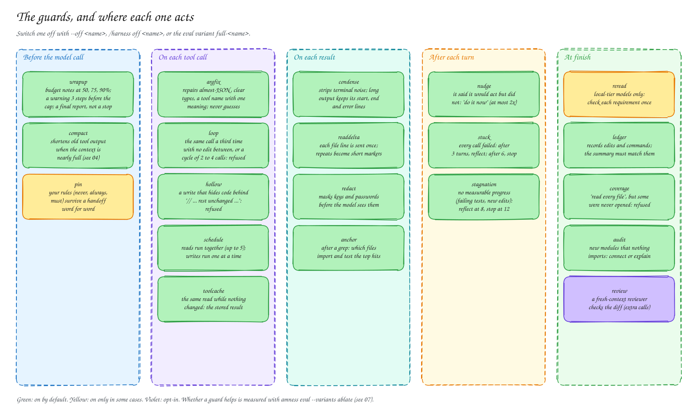
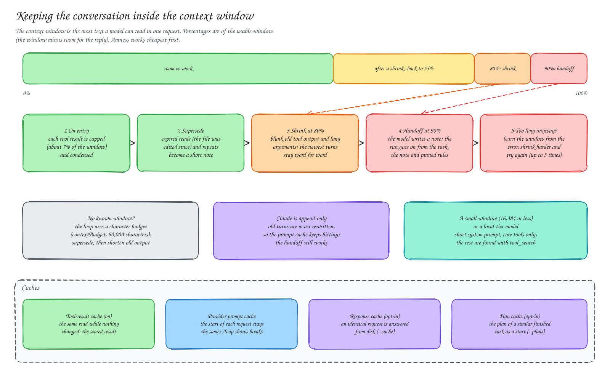
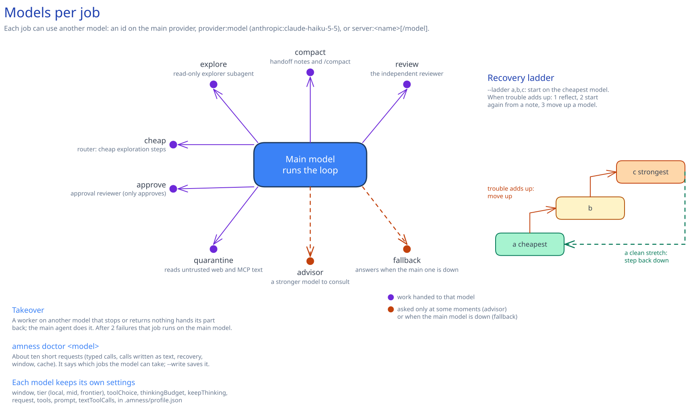
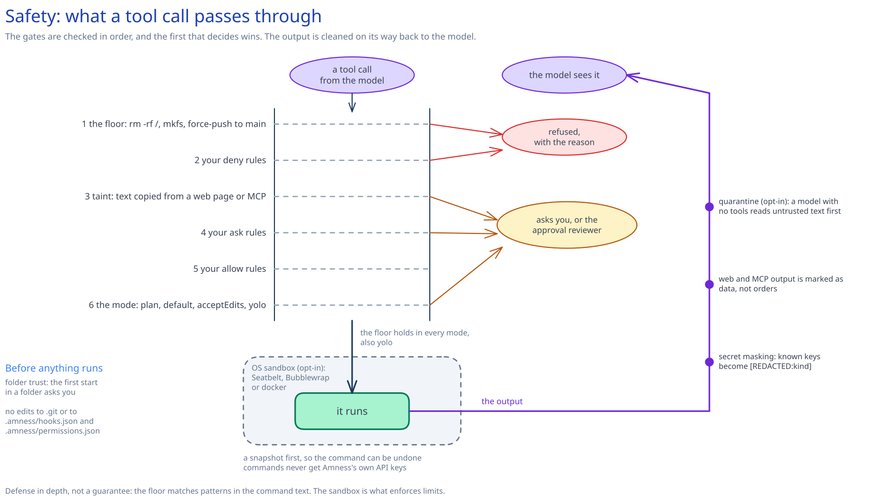
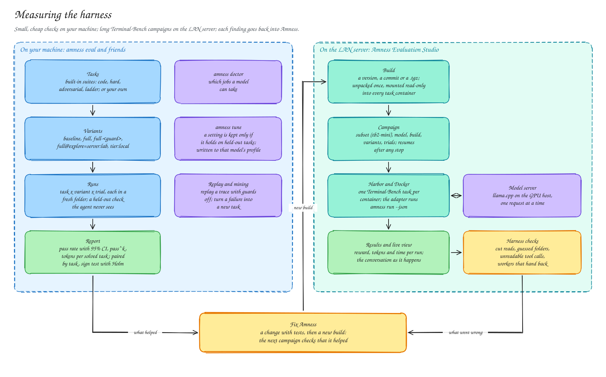
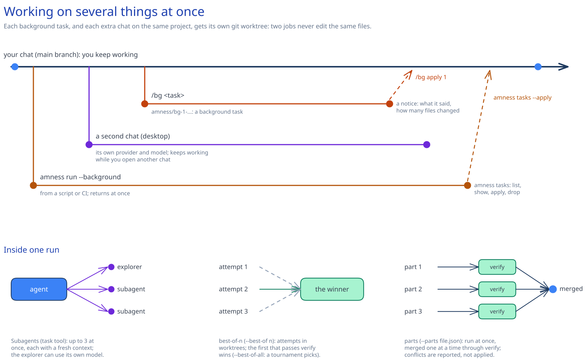

# Pictures of the harness

Eight drawings show every part of Amness: how it works, one turn of the loop, the guards, context, models, safety, measurement and parallel work.

In this page you will learn:

- how the parts of Amness fit together, one picture per topic
- which page explains each picture in words
- how to change a picture and draw it again

Each picture is an Excalidraw drawing. *Excalidraw* is a free drawing tool. GitHub shows the `.svg` file here. The `.excalidraw` file next to it opens in [excalidraw.com](https://excalidraw.com) or in the Excalidraw extension for VS Code, so you can move things and add notes.

Each picture answers one question and uses the shape that fits it: a flow for the system, a cycle for the loop, a timeline for the guards, a gauge for the context, a fan-out for models, a filter for safety, and git branches for parallel work. Details stay next to the thing they describe, not in boxes.

## See the whole system

Your task goes to the agent. The loop sends messages to a model and runs the tools it asks for, until the work is checked. The notes on the right link to the other pictures.



Read more: [Architecture](architecture.md).

## Follow one turn of the loop

What `run()` in `src/harness.ts` does in one step: steer, budget, compact, model call. Then each tool call goes down its checks, or a `finish` call goes down the finish gate on the right. The order of the checks is the order in the code.



Read more: [The agent loop](agent-loop.md#see-how-one-turn-works).

## Find where each guard acts

A *guard* is a rule in the loop that stops a known mistake. The picture puts each of the 20 guards on a timeline of one turn, at the moment it acts. The colour of the dot says whether it is on by default.



Read more: [Guards](agent-loop.md#guards).

## See how the context stays small enough

The *context window* is the most text a model can read in one request. The bar shows when Amness acts (at 80% and 90%). The timeline shows the five stages, cheapest first.



Read more: [Keeping inside a context window](agent-loop.md#keeping-inside-a-context-window).

## Give jobs to other models

Each job (explore, compact, review and more) can use another model, on any provider or saved server. The stairs on the right are the recovery ladder: start cheap, move up when trouble adds up, step down again after a clean stretch.



Read more: [Models per job and a fallback](features.md#models-per-job-and-a-fallback), [Providers and models](providers.md).

## Check what protects you

A tool call drops through six gates, in order. A gate can refuse it or ask you. Then it runs, in the sandbox when that is on, and the output is cleaned on its way back up to the model.



Read more: [Safety and privacy](safety.md).

## Measure a change

Small checks on your machine with `amness eval` (left). Long Terminal-Bench campaigns on a server with [Amness Evaluation Studio](https://github.com/amirsdream/amness-eval-studio) (right): a cycle in which each campaign checks the last fix.



Read more: [Evaluating the harness](evaluation.md), [Run Amness on Terminal-Bench](../bench/harbor/README.md).

## Work on several things at once

Background tasks, a second chat and background runs branch off your work like git branches, each in its own worktree, and come back when you apply them. Below: the three ways one run can use several agents.



Read more: [Work on several things at once](features.md#work-on-several-things-at-once-background-tasks-and-live-chats), [Several agents at once](features.md#several-agents-at-once-best-of-n-and-parallel-parts).

## Change a picture

The `.excalidraw` files are the source. The `.svg` files are made from them.

1. Open the `.excalidraw` file in [excalidraw.com](https://excalidraw.com) (**Open**) or in the Excalidraw extension for VS Code. Change it and save it with the same name.
2. Make the SVG again with Excalidraw's own exporter. The first time, install the browser it uses:

   ```bash
   uv run --with playwright playwright install chromium
   ```

   Then export one picture, or all of them:

   ```bash
   uv run scripts/diagrams/export.py docs/diagrams/02-one-turn.excalidraw
   uv run scripts/diagrams/export.py
   ```

3. Open the `.svg` file in a browser to check it. Commit both files.

**Limits.**

- The exporter loads Excalidraw 0.18.0 from esm.sh, so it needs the internet.
- The pictures show the main paths, not every file. When the code changes, check that the matching picture still says the same thing.
- GitHub shows the pictures on a white background, also in dark mode.

## Next steps

- [Architecture](architecture.md): which file does what.
- [The agent loop](agent-loop.md): the loop and the guards in words.
- [Evaluating the harness](evaluation.md): measure a guard on your own tasks.
