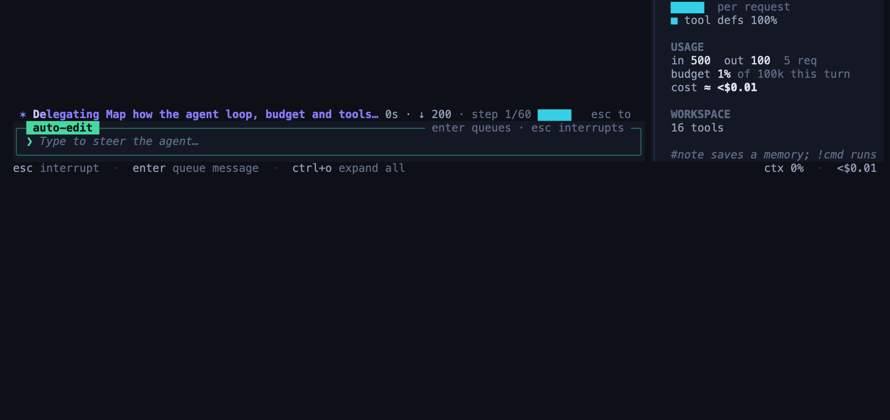
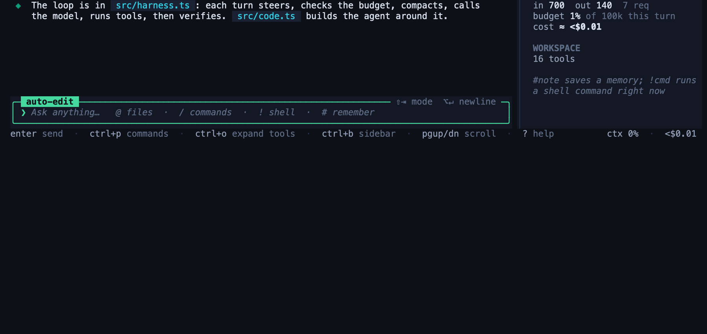

# Getting started

This tutorial takes you from zero to a first useful session: you ask a question, change a file, undo the change, and make the agent prove its work.

In this page you will learn:

- how to install Amness and set an API key or a local model
- how to ask a question and ask for a change
- how to read, approve and undo a diff
- how to make the agent prove its work and save a memory note

You need Node.js 22.18 or newer, git, and a terminal. A *diff* is a view of the lines that a change adds and removes.

## 1. Install Amness

Amness is **not on npm yet**. You install it from the source code.

1. Download the code and install its packages.

   ```bash
   git clone https://github.com/amirsdream/Amness.git && cd Amness && npm install
   ```

2. Create the `amness` command.

   ```bash
   npm link
   ```

3. Check that the command works.

   ```bash
   amness --version
   ```

   You see a version number, for example `0.1.0`.

Amness is developed on macOS and Linux. The tests also run on Windows, but Windows has **no OS sandbox** for shell commands.

## 2. Set an API key or choose a local model

A *provider* is the service that runs the model. Choose one way.

**Option A: a cloud provider.** Set the key in your terminal. Use the key for the provider that you want.

```bash
export ANTHROPIC_API_KEY=sk-ant-...
```

For OpenAI, use `OPENAI_API_KEY=sk-...` instead. OpenAI is the default provider. If you set only an Anthropic key, run `/provider` in the chat and choose Claude.

**Option B: a local model.** Install Ollama, then download a model that supports tool calling.

```bash
ollama pull qwen2.5-coder:7b
```

Start Amness, run `/provider`, and choose "Ollama (local)". You need no key. Small local models can be weak at tool calling. See [Providers and models](providers.md).

You can also do nothing now. On the first start, Amness asks you to pick a provider and paste a key. It saves the key in `~/.amness/config.json`, where only you can read it.

## 3. Start in a project

Go to a project that is under git, then start the chat.

```bash
cd ~/your-project
amness
```

You see the full-screen chat: a header, a transcript, a sidebar and an input box.


The default mode is `default`. In this mode Amness asks before it edits a file or runs a risky command.

## 4. Ask a question

Type a question and press `Enter`. Use `@` to attach a file.

```text
❯ what does @package.json say about how to run the tests?
```

The agent reads files and answers. Reads and searches collapse into one row, for example "Explored · 2 files read". Click the row to see the details. Nothing changes in your project, because a question only reads files.

## 5. Ask for a change

Now ask for a small change.

```text
❯ add a short "Contributing" section to the README
```

The agent works. The status line shows what it does, and the sidebar shows its progress.

## 6. Read and approve the diff

Before Amness edits a file, it stops and shows a window with the exact diff. Green lines are added. Red lines are removed.


1. Read the diff.
2. Choose "Yes" to apply this one edit. Choose "No, and tell Amness what to do instead" (or press `Esc`) to refuse and give a different instruction.
3. Choose "Yes, and accept all edits this session" only if you trust the task. Edits then apply without asking.

For shell commands, Amness shows the command and asks "Run this command?". Read-only commands such as `ls` and `git status` never ask.

## 7. Undo the change

If you do not like the result, undo the whole turn. This reverts the files and the conversation.

```text
❯ /undo
```

You see a line such as `rewound the conversation to before turn 2 · restored 1 file(s)`. Use `/diff` to review all changes of the session before you decide. Use `/rewind` to go back to an earlier turn.

Amness also tries to undo changes made by shell commands. Some commands cannot be undone. In that case Amness lists them.

## 8. Make the agent prove its work

By default, an agent can say "done" when the work is not done. A *verify command* is a command that must pass before the agent may finish. If it fails, Amness rejects the finish and the agent must try again.

1. Choose a command that tests your project. Amness picks one for you when it finds `npm test`, `cargo test`, `go test ./...` or `pytest -q`. Type `/status` and look at the `verify` line.
2. Set or change it in the chat.

   ```text
   ❯ /verify npm test
   ```

   You see `verify gate → npm test`.
3. Ask for a change that touches the code.

   ```text
   ❯ the date parser fails on leap days, fix it
   ```

4. Watch the end of the turn. If the command fails, you see a note such as "finish rejected by verification" and the agent continues. If it passes, the agent finishes.

For a run without a chat, the flag is `--verify`:

```bash
amness run --verify "npm test" "fix the failing test"
```

The `--verify` flag belongs to `amness run`. In the chat, use `/verify`. See [Headless and CI](headless.md).

You can also set `/check <cmd>`, a fast command (for example a type check) that runs after every edit.

## 9. Save a memory note

A *memory note* is a short text file that the agent can read in later sessions. Start a line with `#` to save one.

```text
❯ # run tests with npm test, never with npx jest
```

You see "remembered" and the note name. Type `/memory` to list your notes. Notes live in `.amness/memory` in your project.

## 10. Go further

Two more screens help you understand what the agent does. Subagents are helpers that the agent starts for large searches. You see one card while it runs and a summary when it ends.





Type `/loop` to see every model turn, its tools and timings.


Type `/tokens` to see how full the context is and what the session costs. Costs are estimates.

When you finish, type `/exit` or press `Ctrl+C` twice. Your conversation is saved. Next time, run `amness -c` to continue it.

## If something goes wrong

| What you see | What it means | What to do |
|---|---|---|
| The first start asks for a provider and key, or a message says "no API key" | Amness has no key for the provider. In `amness run`, the message is `no API key for <provider>. Set ANTHROPIC_API_KEY or OPENAI_API_KEY or run amness settings`. | Set the key (step 2), or run `/provider`. For a local model, choose Ollama. |
| "check your key with /provider" | The provider rejected the key (401 or 403). | Run `/provider` and enter the key again. |
| "rate limited by the provider: waiting 12s, then retrying" | The provider has limits on requests and tokens each minute. Amness waits and retries for you. | Wait. If it happens often, set a lower `"maxConcurrent"` in `~/.amness/config.json`. Quota and billing errors are not retried. |
| "token budget exhausted" or a line starting with `stopped:` and a budget message | The turn used its token cap (300,000 by default). Amness asks the model to wrap up at 50, 75 and 90 percent and writes a final report. | Read the report. Send a message to continue, ask a smaller question, or raise the cap with `/budget 500k`. |
| "denied: ..." | A permission rule or the safety floor refused the command. In `amness run`, risky commands are denied unless you pass `--yes`. | Read the reason. Use `/policy` to see why. Allow the command with `/permissions allow sh(npm test*)`, or in `amness run` pass `--yes` in a safe place. |
| "finish rejected by verification" | Your verify command failed. | This is the gate working. Let the agent fix the problem, or check that the command is right with `/verify`. |
| "interrupted. Your progress is kept" | You pressed `Esc` or `Ctrl+C`. | Send a message to continue. |

## Next steps

- [Using the chat](usage.md): all keys, modes and slash commands.
- [Providers and models](providers.md): OpenAI, Claude and local models.
- [Headless and CI](headless.md): run Amness in scripts.
- [Safety and privacy](safety.md): what the permission system protects.
- [Budgets and subagents](budgets.md): why runs stop and how to control cost.
- [Features in depth](features.md): worktrees, pull requests, hooks, skills and more.
