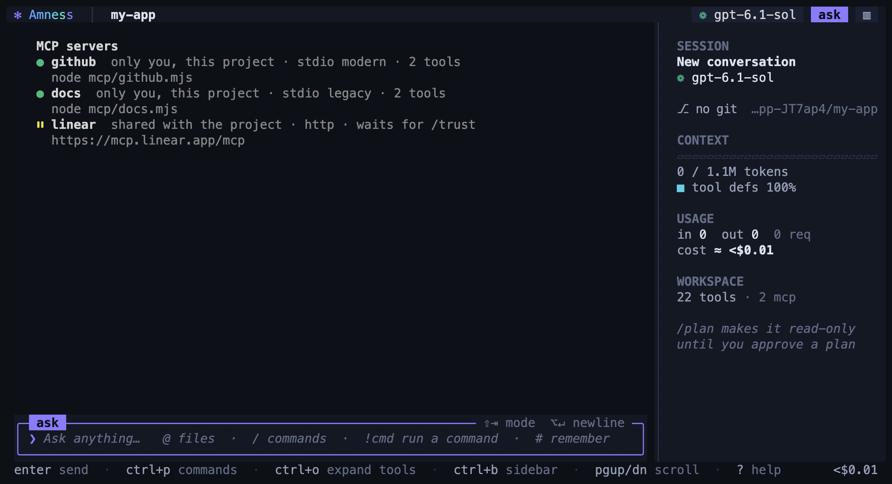

# MCP servers

An MCP server is a program that gives the agent more tools: GitHub, a database, a browser, your issue tracker. Amness speaks the Model Context Protocol (MCP) version `2026-07-28` and the older versions, over stdio (a program on your computer) and over HTTP (a server on the network).

The same servers work everywhere: in the terminal app, in the desktop app, in `amness run`, and in editors that use Amness through ACP.



## Add a server

```bash
amness mcp add github https://api.githubcopilot.com/mcp/ -H "Authorization: Bearer ${GITHUB_TOKEN}"
amness mcp add files -- npx -y @modelcontextprotocol/server-filesystem .
amness mcp list
```

In the chat, `/mcp add <name> <url or command>` does the same. `/mcp` shows every server and its status.

| Command | What it does |
|---|---|
| `amness mcp add [options] <name> <url>` | A remote server (Streamable HTTP). `--transport sse` for the old HTTP+SSE servers. |
| `amness mcp add [options] <name> -- <command> [args…]` | A program started on your computer (stdio). |
| `amness mcp add-json <name> '<json>'` | One entry in `.mcp.json`'s format. |
| `amness mcp list` | Every server, where it comes from, and whether it connects. |
| `amness mcp get <name>` | One server's settings and its tools. |
| `amness mcp remove <name>` | Removes it. |
| `amness mcp enable <name>`, `disable <name>` | Switches one on or off for this project only. |
| `amness mcp check [name]` | Connects, says how long it took, and looks for hidden instructions in the tool descriptions. |
| `amness mcp approve <name>` | Accepts tools that changed since you approved the server. |
| `amness mcp login <name>`, `logout <name>` | Signs in to a remote server in your browser (OAuth), or forgets the sign-in. `--no-browser` only prints the link. |

Options for `add`: `--scope local|project|user` (see below), `-e KEY=value` (stdio), `-H "Name: value"` (HTTP), `--headers-helper <command>`, `--timeout <ms>`.

In the chat:

| Command | What it does |
|---|---|
| `/mcp` | Every server: connected, waiting for trust, switched off or failed (with the error). |
| `/mcp add [--scope …] <name> <url or command…>`, `/mcp remove <name>` | Adds or removes a server, then connects. |
| `/mcp enable <name>`, `/mcp disable <name>` | On or off for this project. |
| `/mcp reconnect [name]` | Connects again (after the server restarted, or after you signed in). |
| `/mcp tools <name>` | The server's tools, which ones ask before they run, which are held back, and warnings about their descriptions. |
| `/mcp approve <name>` | Accepts tools that changed since you approved the server. |
| `/mcp login <name>`, `/mcp logout <name>` | Signs in to a remote server, or forgets the sign-in. |
| `/mcp <command…>` or `/mcp <url>` | Attaches a server for this session only. `/mcp off` detaches those. |

## Where servers are saved

| Scope | File | Who uses it |
|---|---|---|
| `local` (default) | `.amness/settings.local.json` in the project | Only you, only this project. Amness keeps the file out of git (it adds it to `.git/info/exclude`). |
| `project` | `.mcp.json` in the project | Everyone who clones the project. This is Claude Code's file, so a project that already has one works in Amness too. |
| `user` | `~/.amness/config.json` | You, in every project. |

If the same name is in two places, `local` wins over `project`, and `project` wins over `user`. The higher entry is used as a whole.

The files use the `mcpServers` format of Claude Code and Claude Desktop:

```json
{
  "mcpServers": {
    "files": { "command": "npx", "args": ["-y", "@modelcontextprotocol/server-filesystem", "."], "env": { "DEBUG": "0" } },
    "issues": { "type": "http", "url": "${ISSUES_URL:-https://issues.example.com}/mcp", "headers": { "Authorization": "Bearer ${ISSUES_TOKEN}" } },
    "old": { "type": "sse", "url": "https://old.example.com/sse" }
  }
}
```

- `${VAR}` takes the value from your environment, and `${VAR:-default}` gives a default. If a variable is not set, Amness tells you.
- `headersHelper` is a command that prints a JSON object of headers, for example a token from your password manager. It runs when the server connects, and again after a 401 or 403 answer.
- `timeout` is the limit for one call, in milliseconds (the default is 10 minutes).
- `"disabled": true` keeps the entry but does not start it.

## Sign in to a remote server

Many remote servers need you to sign in (GitHub, Linear, Notion and others). When a server answers "401", `/mcp` shows it as needing sign-in. Run `amness mcp login <name>` or `/mcp login <name>`. Your browser opens the server's sign-in page. When you are done, Amness connects.

- Amness follows the MCP sign-in rules (OAuth 2.1). It finds the server's sign-in service from the server itself, registers itself there if it can, and uses PKCE. It names the server the token is for (`resource`). It checks that the answer comes from the same sign-in service (`iss`) before it uses it.
- The answer comes back to a short-lived local address (`http://127.0.0.1:<port>/callback`). Over SSH, use `amness mcp login <name> --no-browser`, forward the port shown in the link, and open the link on your own computer.
- Tokens are saved in your system's key store (macOS Keychain, Windows DPAPI, the Linux keyring), else in `~/.amness/mcp-auth.json`, which only you can read. In a container they are kept in memory only. Amness renews a token before it runs out.
- Some sign-in services need a client id that you register yourself: `amness mcp add <name> <url> --client-id <id> [--client-secret <secret>] [--callback-port <n>] [--scopes "a b"]`. In a shared `.mcp.json`, write the secret as `${VAR}`.
- Not supported yet: Client ID Metadata Documents (they need a public web address for Amness). Amness uses dynamic registration or your client id instead.

## Prompts, resources and questions

- **Prompts.** A server's prompts become commands: `/mcp__<server>__<prompt> [arguments]`. They are listed in the `/` menu and the desktop command palette. Amness asks for any required argument you did not give. The prompt's text is sent as your message.
- **Resources.** When a server offers resources (documents, records, files), the model gets two tools: `list_mcp_resources` and `read_mcp_resource`.
- **Questions from a server.** During a call, a server can ask you something: a short form, or a page to open (for example to confirm a payment or to sign in to another service). The terminal and the desktop app show the question in their own dialog, and your answer goes to that server only. In `amness run` and in editors, nobody can answer, so Amness declines. Amness supports both ways of asking: the 2026-07-28 way (the answer comes with a repeat of the request) and the older way (a request from the server).

## Safety

- **A project's servers need your yes.** The servers in a cloned project's `.mcp.json` start only after you trust the project. The terminal app asks once, together with the project's hooks and permission rules. If the file changes, it asks again. `/trust` shows the state and asks again. Until then, `/mcp` shows them as waiting.
- **Your API keys stay yours.** In a remote server's address or headers, the keys of your model providers (`OPENAI_API_KEY`, `ANTHROPIC_API_KEY` and the others) are always empty. So a project file cannot send them to a server it names.
- **The agent cannot add servers.** `.mcp.json` is protected like `.amness/hooks.json`: the agent may read it, but it may not write it.
- **A changed tool waits for you.** The first time a server connects, Amness remembers what each tool says about itself (its description and its input schema). If that changes later, or a new tool appears, the tool is held back: the model does not see it. The terminal and the desktop app show the old and the new text and ask. `amness run` and editors leave the tool out and say so. `/mcp approve <name>` or `amness mcp approve <name>` accepts the new versions. This protects you from a server that changes its descriptions after you trusted it (a "rug pull").
- **Suspicious descriptions are flagged.** Amness looks for signs of hidden instructions in tool descriptions: invisible characters, "ignore previous instructions", tags like `<IMPORTANT>`, requests to hide something from you, mentions of key files such as `~/.ssh/id_rsa`, and requests to send data somewhere. `/mcp` and `amness mcp check` show what it found. This is a heuristic: read the descriptions yourself with `amness mcp get <name>`.
- **Very long results go to a file.** A result longer than 40,000 characters would fill the context. The model gets the first part and the path of a file in `.amness/mcp-output/` with the whole result, and can read the parts it needs. The folder has its own `.gitignore`, so it is never committed.
- **Tools that change things ask first.** A tool the server marks as destructive, or does not mark as read-only, needs your approval. Your permission rules work on MCP tools too (the name is `<server>__<tool>`).
- **Answers are data.** What an MCP tool returns is marked as untrusted. The taint check and quarantine (see [safety](safety.md)) apply to it.
- **A stdio server runs as you.** It gets your environment plus the `env` you give it. Only add servers you trust.

## In `amness run`

`amness run` starts your servers (`local` and `user`). It starts the project's `.mcp.json` servers only with `--trust-project`.

| Option | What it does |
|---|---|
| `--mcp-config <file or JSON>` | Servers for this run, in the `mcpServers` format. You can give it more than once. |
| `--strict-mcp-config` | Use only the `--mcp-config` servers. |
| `--no-mcp` | No MCP servers. |

## In an editor (ACP)

Editors such as Zed send their own MCP servers when they open an Amness session. Amness starts them (stdio, HTTP and SSE), plus yours, plus the project's if you trusted the project in the terminal app.

## Use Amness from Claude Code, Codex or another agent

Amness is also an MCP server, so other agents can hand it a task:

```bash
claude mcp add amness -- amness mcp serve                 # Claude Code
codex mcp add amness -- amness mcp serve                  # Codex
```

Or, when `amness serve` runs (see [Amness as a service](api.md)), connect to `http://<host>:4747/mcp` with the header `Authorization: Bearer <token>`. These sessions are the same as the API's, so you can watch them in the browser.

| Tool | What it does |
|---|---|
| `amness_run` | Starts a session on a task in a folder, and waits up to `wait_seconds` (default 50). Returns the session id, its status (`idle` = done, `running`, `waiting` = it needs an answer), and the answer or the question. |
| `amness_status` | Waits for a session again, and returns its answer or question. |
| `amness_reply` | Sends a follow-up message. |
| `amness_answer` | Answers the question or approval a session is waiting for: an option number, text, or `cancel`. |
| `amness_sessions`, `amness_close` | Lists the open sessions, or closes one. |

A task can take longer than one tool call may wait (Codex stops a call after 60 seconds by default). So `amness_run` returns a session id, and the caller asks again with `amness_status`.

**Approvals.** Amness asks before risky actions, as always. If the calling app can ask its user (MCP "elicitation", for example Claude Code), the question goes to you there. If it cannot, the calling agent sees the question with numbered options and can answer it with `amness_answer`. So only connect agents you would trust to approve such steps, or start sessions in `plan` mode (`amness_run` with `mode: "plan"`, or `amness mcp serve --mode plan`). Sessions may only use the folders given with `--root` (default: the folder where it starts).

Tested with the official MCP TypeScript SDK (version 1.32): its client used `amness mcp serve`, and Amness's client used the SDK's "everything" example server (tools, prompts, resources), with protocol 2026-07-28.

## Protocol details

- Version `2026-07-28` first: no handshake. The protocol version, the client name and the client's capabilities go with every request. On HTTP, the request also sends the `MCP-Protocol-Version`, `Mcp-Method`, `Mcp-Name` and `Mcp-Param-*` headers. If a tool's `x-mcp-header` is not valid, the tool is left out, with a warning.
- Older servers: Amness falls back to the `initialize` handshake (`2025-11-25`, with a session id on HTTP), and then to the old HTTP+SSE transport (`2024-11-05`), as the specification describes.
- A server that answers 401 is shown as needing sign-in.
- A server with more than 15 tools has them behind `tool_search`, so the prompt stays small.
