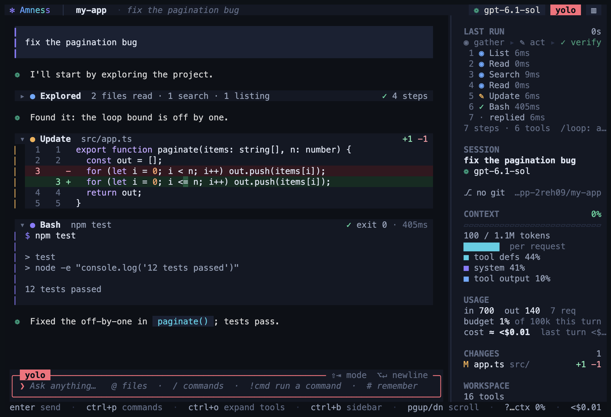
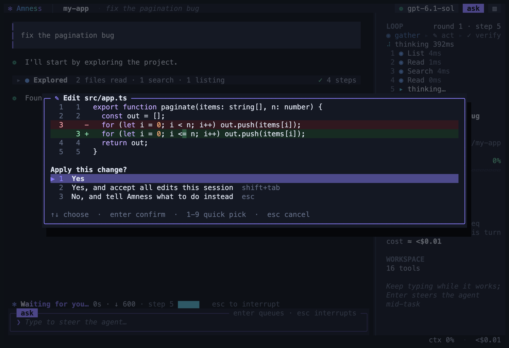
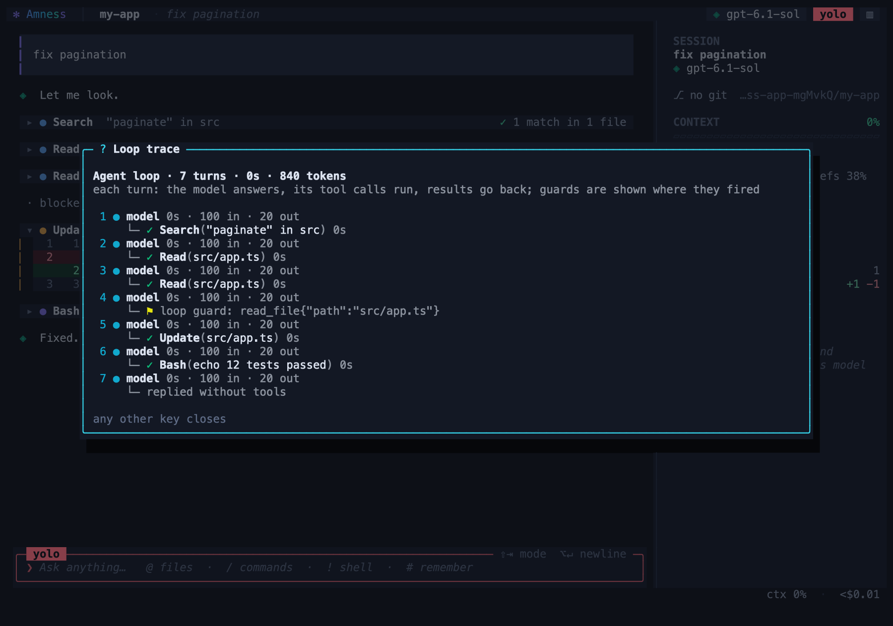

# Using the chat

The chat is where you talk to Amness: you type a request, the agent reads and changes your code, and you approve or reject each risky step.

In this page you will learn:

- how to start the chat and choose the full-screen or the inline interface
- which keys and prefixes (`@`, `/`, `!`, `#`) you can type in the input box
- how permission modes decide when Amness asks you
- what every slash command does

If you are new, read [Getting started](getting-started.md) first.

## Start the chat

**What it is.** `amness` opens a chat in your terminal. It needs an interactive terminal. For scripts, use [headless mode](headless.md).

**Why you would use it.** You see every step the agent takes, and you decide which changes are allowed.

**How to start.**

1. Go to your project folder.

   ```bash
   cd ~/your-project
   ```

2. Start the chat.

   ```bash
   amness
   ```

Other ways to start:

| Command | What it does |
|---|---|
| `amness "fix the failing test"` | Starts with a first request. |
| `amness -c` | Continues the most recent conversation in this folder. |
| `amness --resume <id>` | Continues a specific conversation. |
| `amness --worktree [name]` | Works in a new git worktree on its own branch. Your main checkout stays untouched. It needs a git repository with at least one commit. |
| `amness --inline` or `amness --full` | Chooses the interface. |
| `amness menu` | Opens the classic menu (demo, evals, research, memory, settings). |
| `amness demo` | A guided demo that needs no API key. |

If you have no key yet, the first start asks you to pick a provider and paste a key. See [Providers and models](providers.md).

**Limits and common problems.**

- If the terminal is smaller than 60 columns or 14 rows, or if `TERM=dumb`, Amness uses the inline interface.
- `amness` in a pipe or a script stops with exit code 2 and tells you to use `amness run`.

**Related pages.** [Getting started](getting-started.md), [Headless and CI](headless.md).

## Read the full-screen interface

**What it is.** The default interface has a header (project, branch, model, mode), a scrollable transcript made of cards, a session sidebar, an input panel and a status line.

**Why you would use it.** It shows what the agent is doing while it works, and it keeps long output short.

- **Collapsed reads.** A run of reads and searches becomes one row, for example "Explored · 3 files read · 2 searches". Click it to open it. Edits, commands and failures always get their own card. Long diffs show the first 16 rows, and you click to see the rest.
- **Cards.** Your prompts, the assistant replies (with code blocks that have a copy button), tool cards with a status chip, and diffs with line numbers and word-level marks. Wide terminals show a split view.
- **Live run view.** The status line says what the agent does now, for example "Reading src/app.ts" or "Waiting for you". It also shows elapsed time, tokens and the step number. The sidebar has a **LOOP** panel that draws the cycle the agent goes round and lights the part that is running:

  ```text
  LOOP                round 2 · step 14
  ◉ gather ▸ ✎ act ▸ ✓ verify
  ⠋ Updating src/app.ts  2.1s
   12 ◉ Search → Read ×2     3.1s
      ⚑ nudged: no edits after
        5 reads
   13 ✎ Update               0.8s
   14 ✎ …
  ```

  - **gather** ◉ (blue): reading, searching, listing files, asking a subagent, shell commands such as `ls` or `git diff`.
  - **act** ✎ (amber): editing and writing files, and shell commands that change things.
  - **verify** ✓ (green): shell commands that look like tests, builds, linting or type checks (`npm test`, `pytest`, `tsc`, `cargo test`…), the `check` command, and the verify gate when the agent says it is done.

  The bright stage is the one running now. When two kinds run together, both light up. While the model is thinking and nothing runs, the stage it used last stays visible but dimmer. A test that failed keeps the verify icon red until a later one passes. A **round** is one trip round the cycle: it counts up when the agent gathers or acts again after verifying, so "round 3" means it went back to work twice after checking.

  **These stages are a guess.** Amness reads them from the tool calls, and the loop itself has no such phases. An unusual shell command can be put in the wrong stage, and a step where the model only thinks has no stage.

  Under the cycle you see the latest steps, one line each: the stage icons, the tools used, and the time. Calls of one kind in a row merge (`Read ×2`). A red `✗` means a tool failed. A line with `⚑` means the harness stepped in (a nudge, a loop or stagnation warning, a rejected finish, a denied call, a reviewer finding). It stays visible even when the step is older. **Click a step** to see every tool call with its time. A tall sidebar shows more steps than a short one, and older ones fold into one line. Type **`/loop`** for the whole history of the run, with every turn labelled by its stage. When the run ends, the panel stays as **LAST RUN**.

  The step limit is a safety stop, not a goal, so it stays hidden at first. It appears as "of 60" after half the steps and as a yellow bar with a warning at 80%.
- **Sidebar** (`Ctrl+B`). It shows the session, a context gauge, token use, todos, changed files and the workspace. The *context* is the text the model can read at one time.
- **Modals.** Windows for approvals (with the diff, command or plan), the command palette (`Ctrl+P`), pickers and help.



**Copy text.** Drag to select and copy, in the transcript, the sidebar or a modal. A double-click copies a word and a triple-click copies a line. `/copy` copies the last reply, `/copy code` copies its last code block, and `/copy all` copies the whole conversation. Copy uses the system clipboard and OSC 52, so it can also work over SSH in terminals that support it. To use your terminal's own selection, hold **Shift** (**Option** in iTerm2) while you drag, or run `/mouse off`.

**Open links.** Web links in the agent's replies are underlined. Click one to open it in your browser. A double-click copies the address instead. Amness shows "opening example.com" first, so you see where it goes, and it opens only plain `http` and `https` addresses (never `file:`, `javascript:` and the like). A long link that wraps over several lines is still one link. If no browser can be started (for example over SSH or in a container), Amness copies the address and tells you. Links in code blocks and in tool output are not clickable yet; select and copy them. Amness captures the mouse, so your terminal's own link feature (Cmd-click or Ctrl-click) does not see these links; `/mouse off` hands the mouse back to the terminal.

**Mouse.** You can scroll with the wheel, click a card to open or close it, click the model or mode chips in the header, and click suggestions and modal options. A "Jump to bottom" pill and a sticky prompt appear when you scroll up.

**Themes.** `aurora` (default), `tokyo-night`, `catppuccin`, `gruvbox`, `nord`, `daylight` (light) and `terminal` (transparent). `/theme` shows a live preview, and `Ctrl+T` goes to the next theme. Amness uses truecolor and falls back to 256 or 16 colours.

**Limits and common problems.**

- The sidebar, `/theme`, `/details`, `/diffmode` and `/mouse` work only in the full-screen interface. In inline mode they tell you to run `/ui full`.

## Use the inline interface

**What it is.** The inline interface keeps one conversation and a pinned input box. Finished output goes into your normal terminal scrollback.

**Why you would use it.** Native scrolling, selection and copy keep working. It is also the fallback for small terminals.

**How to use it.** Use any one of these:

```bash
amness --inline
```

- Set `ui: "inline"` in `~/.amness/config.json`.
- Set the environment variable `AMNESS_UI=inline`.
- Type `/ui inline` in the chat. `/ui full` goes back.

**What you see.** Each tool call is one line, for example `● Read(src/a.ts)`, with a short result. `Ctrl+O` shows everything. Each edit shows a diff with line numbers.

In the full-screen view, the **most recent** tool call stays open. A shell command shows `$ the command` and its output, up to 20 lines. When the next tool call starts, the earlier one folds to one line again. Click a line to open or close it yourself. If the output is longer than 20 lines, the card says how many are hidden. Type `/output` to read all of it in a pager (`/output 2` for the call before). A lone file read does not open itself. A live todo list, a status line (elapsed time and tokens) and a footer (permission mode, git branch, model, context gauge, estimated cost) stay visible. Tool bullets have a colour for each kind and turn red when the tool fails. With `NO_COLOR=1`, or when the output is piped, Amness uses plain text.

## Type in the input box

**What it is.** The input box accepts plain requests and four special prefixes.

| You type | What happens |
|---|---|
| `Enter` | Sends the message. While the agent works, the message waits in a queue and goes to the agent between steps. |
| `\` then `Enter`, `Alt+Enter`, or `Ctrl+J` | Adds a new line. |
| Paste | A multi-line paste is one input. A large paste becomes `[Pasted text #1 +40 lines]` and expands when you send. |
| `@path` | Mentions a file. A fuzzy popup helps you choose it, and the file contents are attached. |
| `/` | Opens the command popup. You can also search by alias. |
| `!cmd` | Runs a shell command now. Its output is added to the context for your next message. |
| `#note` | Saves a memory note. |
| `Ctrl+P` or `Alt+M` | Opens the command palette or the model picker. |
| `Shift+Tab` | Goes to the next permission mode. |
| `Esc` | Interrupts the agent at a safe point, or closes a popup. Pressing `Esc` twice when the box is empty opens rewind. Pressing it twice when the box has text clears the box. |
| `Ctrl+C` | Interrupts the agent. If the agent is idle, it clears the input. If the input is empty, press it twice to exit. |
| `Ctrl+D` | Exits when the input is empty. |
| `Ctrl+O` | Opens or closes all tool details (in inline mode, a scrollable transcript). |
| `Ctrl+L` | Redraws the screen. |
| `?` | Shows the shortcuts (when the input is empty). |
| `Ctrl+B`, `Ctrl+T` | Full-screen only: toggle the sidebar, change the theme. |
| `PgUp`, `PgDn`, `Ctrl+Home`, `Ctrl+End` | Scroll the transcript, jump to the end. |
| `Ctrl+R` | Searches your earlier messages. Type part of one, then press `Enter` to put it in the input box. |
| `Ctrl+Z`, `Ctrl+Y` | Undo and redo while you type (`Ctrl+_` also undoes). Typing in one place is one step. |
| `Ctrl+G` | Opens your message in your own editor (`$VISUAL` or `$EDITOR`, for example `code --wait`). When you save and close it, the text comes back. |
| `Ctrl+V` | Pastes an image from the clipboard. It is saved in `.amness/paste/` and mentioned, so it goes with your next message. |
| `Ctrl+F` | Full-screen only: finds text in the conversation. Matches are highlighted as you type. `↑` `↓` go to older or newer matches, `Enter` stays there, `Esc` goes back. |
| `Alt+↑`, `Alt+↓` | Full-screen only: jump to your previous or next message. |
| Click a file path | Full-screen only: a path in a reply, such as `src/app.ts:12`, opens in your editor at that line. |

**Vim mode.** `/vim` turns on vim-style editing in the input box. `Esc` switches to normal mode. There you can use `h j k l w b e 0 ^ $ gg G`, `x X D C S`, `dd dw cw yy p P`, `u` (undo), `Ctrl+R` (redo) and counts such as `3w`. `i a I A o O` go back to typing. `Enter` sends the message.

**Notifications.** If a turn takes more than 20 seconds, or the agent needs your approval while you are in another window, Amness shows a desktop notification. It uses your terminal's own notification when the terminal supports it (iTerm2, WezTerm, Ghostty, kitty, Windows Terminal), and the system notifier otherwise. Nothing is shown while the terminal is in front. `/notify off` turns this off, and `/notify test` sends a test notification.

**Sessions.** `/rename <name>` names the current conversation. `/resume` shows a preview of each conversation, and you can type to search. `amness chat --resume <name>` starts with a named conversation.

**Example.**

```text
❯ explain what @src/index.ts exports
```

The file is attached to your message. In the transcript you see a note such as "attached src/index.ts (120 lines)". The count is an example.

**Limits and common problems.**

- A slash command other than the live ones (for example `/help`, `/diff`, `/tokens`, `/todos`, `/loop`, `/copy`) must wait: while the agent works, Amness says "finish or interrupt (esc) before running commands".
- `@` mentions attach at most 40,000 characters of file text.
- `!cmd` stops after 120 seconds.

## Add images

**What it is.** You can show the model a picture by mentioning it, for example `@screenshot.png`.

**Why you would use it.** The model can read an error screenshot or a design.

**How to use it.**

1. Choose a model that accepts images.
2. Put the picture in your project.
3. Type its path with `@` in your message.

```text
❯ the button in @screenshot.png looks wrong, fix the CSS
```

**Limits and common problems.**

- Allowed types: png, jpg, gif and webp. The limit is 5 MB for each image and 4 images in each message.
- Amness checks the model name to see if it accepts images. If it does not, Amness shows a note and does not send the image. For local models this is a guess from the model name.
- Images stay in the conversation. Amness sends them again with every later request, and you pay for them each time. Start a new conversation with `/clear` when you no longer need them.
- Pasting an image from the clipboard is not supported.
- Image input is tested at the wire-format level. It is not tried on live vision models yet.

**Related pages.** [Features: Image input](features.md#image-input).

## Choose a permission mode

**What it is.** The permission mode decides when Amness asks before it acts. Press `Shift+Tab` or type `/mode` to change it.

**Why you would use it.** You can be strict on code you do not trust and fast on code you do.

| Mode | What happens |
|---|---|
| `default` | Asks before edits (it shows the diff) and before non-trivial shell commands. Read-only commands such as `ls`, `git status` and `grep` never ask. |
| `acceptEdits` | Edits apply without asking. Shell commands still ask. |
| `plan` | Read-only. The agent looks at the code, then shows a plan. You approve the plan before it can change anything. |
| `yolo` | Stops asking for edits and ordinary shell commands. |

**How to answer a question.** When Amness asks, you see the diff or the command and a list of choices. For a risky command you also see two lines. The first says what the command will do, for example `▲ Deletes build and everything in it` (▲ high, ● caution). The second says whether `/undo` can take it back: `↺` yes or partly (not files git ignores, not git history), `✗` no (for example it pushes to a remote, or the folder has no git). The terminal and the desktop app show the same lines. The choices include "Yes", "Yes, and accept all edits this session" (for edits), "Yes, and don't ask again for `npm test`" (for the session) and, for simple commands, "always allow" (this saves a rule in `.amness/permissions.json`). The last choice lets you tell the agent what to do instead.



**Limits and common problems.**

- A *safety floor* applies in every mode, including `yolo`. Amness refuses catastrophic deletes, force-push to main, and edits to `.git` or the rule files. `curl | sh` and force-pushes still ask.
- Shell commands are **not sandboxed** unless you turn the sandbox on with `/sandbox workspace`. It works on macOS and on Linux with bubblewrap. **Windows has no OS sandbox.** In `yolo` mode, use a container or a throwaway checkout with your work committed.
- Rule details are in [Safety and privacy](safety.md) and [Features: Permission rules and the safety floor](features.md#permission-rules-and-the-safety-floor).

## Undo and go back

**What it is.** `/undo` reverts the last turn: the files and the conversation. `/rewind` (or `Esc Esc` on an empty input) lets you pick an earlier turn. `/branch` forks the conversation.

**Why you would use it.** You can try a risky idea and return to a known state.

**How to use it.**

1. Type `/undo` to revert the last turn.
2. Type `/rewind` to choose an earlier turn.
3. Type `/diff` to review all changes of the session.

**Example.** After `/undo` you see a line such as `rewound the conversation to before turn 3 · restored 2 file(s), removed 0`. The numbers depend on your session.

**Limits and common problems.**

- Amness also tries to undo changes made by shell commands. If it cannot, it says so, and it lists commands whose effects cannot be taken back.
- `/branch [n]` keeps the original conversation. It restores files to the state after turn n. `/branches` switches between branches. Switching only changes the conversation. The files stay as they are now. Use `/rewind` or git if the branch needs other files.

**Related pages.** [Features: Undoing what commands did](features.md#undoing-what-commands-did), [Features: Branches, review and pull requests](features.md#branches-review-and-pull-requests).

## Edit an earlier message

**What it is.** `/edit` lets you change a message you sent earlier and send it again. Amness goes back to before that message, then runs your new version.

**Why you would use it.** You asked for the wrong thing, or you want to try the same step with clearer words, without starting a new conversation.

**How to use it.**

1. Type `/edit`, or `/edit 2` for your second message. Without a number, a list of your messages opens.
2. The message appears in the input box. Change it.
3. Press `Enter`. Amness goes back to before that message, including the files it changed after it, and sends your new text. Press `Esc` to cancel.

In the desktop app, hover your message and click **✎ Edit**. Change the text, then click **Save & resend** (or press `⌘/Ctrl+Enter`).

**Limits and common problems.**

- The conversation as it was is kept as a branch named "… (before edit)". Find it with `/resume` or `/branches`.
- Messages you typed while Amness was working are not separate turns, so you cannot edit them.
- Shell commands that cannot be undone are not undone. Amness says so, as with `/rewind`.
- Status: covered by automated tests (terminal, desktop server and the desktop window).

## Change the plan or the todo list

**What it is.** In plan mode, Amness shows its plan and asks if it may start. You can choose **Yes, after I edit the plan**. While Amness works, `/todos edit` changes its checklist.

**How to use it.**

1. When the plan appears, press `3` (**Yes, after I edit the plan**). The plan opens in your editor (`$VISUAL` or `$EDITOR`); in the desktop app, in an editor window. Change, reorder, add or delete steps. Save and close.
2. Amness follows your version. It starts in `default` mode, so it asks before each edit.
3. For the checklist, type `/todos edit`. Each line is one item: `- [ ] to do`, `- [~] doing`, `- [x] done`. In the desktop app, click **Edit list…** in the Todos section.

**Limits.** Amness receives the new todo list with your next message, or between its steps while it works. Status: covered by automated tests.

## Tune the agent loop (`/harness`)

**What it is.** The *harness* is the loop around the model: its guards (checks such as the repeated-call guard) and its limits. `/harness` shows them and lets you change them.

**Why you would use it.** To test whether a guard helps on your work, or to give a long task more steps.

**How to use it.**

1. Type `/harness` for a list. Choose a guard to switch it on or off, or a limit to change it.
2. Or type it directly:

   ```text
   /harness off loop
   /harness steps 80
   /harness stagnation 6
   /harness budget 90000
   /harness reset
   ```

In the desktop app, open **Preferences → Harness**.

| Setting | Default | What it does |
|---|---|---|
| guards (`loop`, `stagnation`, `stuck`, `nudge`, `wrapup`, `ledger`, `coverage`, `compact`, `condense`, `readdelta`, `toolcache`, `schedule`, `redact`, `pin`, `anchor`, `audit`) | all on | each one is explained in the list |
| `steps` | 60 | the most model turns in one run |
| `stagnation` | 8 | turns without measurable progress before the run stops |
| `budget` | 60000 | characters of history before old tool output is shortened (when the context window is not known) |
| `rewrites` | off | shorten old output only when it pays (see [Features](features.md#rewrite-old-messages-only-when-it-pays-library-opt-in)) |

**Limits.** Settings are saved in `~/.amness/config.json`. A model profile can also switch guards off; `/harness` shows that. The guards together were not measured to change the pass rate on real tasks yet. Leave them on unless you are testing.

## Slash commands

Type `/` in the input box to see the popup. It lists **every** command, grouped under titles: Conversation, Model & keys, Safety, Quality, Project, Extend and Interface. Your own and plugin commands go under Custom.

- Move with `↑` and `↓`. `PgUp` and `PgDn` jump eight at a time. The top of the box shows where you are, for example `12/60 ↓`.
- Keep typing to filter. The titles disappear and the best match comes first.
- `Tab` or `Enter` picks the command. `Esc` closes the popup.

**Completion after the command.** Type a command and a space, and the popup lists the values it accepts, each with a short explanation:

| You type | The popup shows |
|---|---|
| `/mode ` | `default`, `acceptEdits`, `plan`, `yolo` |
| `/model ` | the known models with their hints, then every other model your provider reports (OpenAI, Claude, OpenRouter, Ollama and other OpenAI-compatible servers). Amness asks the provider once and remembers the answer for ten minutes. If the provider cannot be reached, you still see the known models. |
| `/models ` | the roles (`explore`, `compact`, `review`, `cheap`, `approve`, `quarantine`, `advisor`, `fallback`), then the models, your saved servers and connected providers |
| `/effort `, `/api `, `/theme `, `/shell `, `/strategy `, `/prompt `, `/sandbox `, `/diffmode `, `/ui ` | their choices |
| `/keepwarm `, `/plans `, `/lsp `, `/approver `, `/reviewer `, `/router `, `/mouse ` | `on`, `off` |
| `/branch ` | your turns, numbered, with the first words of each |
| `/memory `, `/permissions `, `/copy `, `/pr `, `/report `, `/mcp `, `/budget `, `/check `, `/verify ` | their sub-commands or common values |

`Enter` picks the highlighted value and runs the command. For commands that take free text or a number (`/model`, `/budget`, `/check`, `/verify`), `Enter` runs exactly what you typed unless you moved into the list with the arrow keys, so a model id that is not in the list still works. `Tab` always completes. Commands that need more words (`/memory add`, `/permissions allow`) add a space and wait.

`/help` lists the commands in the chat.

### Models and providers

| Command | What it does |
|---|---|
| `/model [id]` | Switches the model. Without an id, it opens a picker. |
| `/output [n]` (alias `/last`) | Shows the full output of the last tool call in a pager. `/output 2` shows the one before. |
| `/provider` | Switches the provider (OpenAI, Claude, OpenRouter, Ollama, custom). The list shows `●` for providers that are connected and `○` for those that are not. Each provider uses its own saved key. |
| `/connect` (alias `/keys`) | Opens the key manager. See which providers are connected, add a key for any of them, replace or remove one, or switch to it. Add as many as you want. |
| `/effort [level]` | Sets the reasoning effort. Levels depend on the model. `default` lets the model decide. |
| `/api [auto\|responses\|chat]` | Chooses the OpenAI wire API. It does not apply to Claude. |
| `/models [role model]` | Uses another model for one job: `explore`, `compact`, `review`, `cheap`, `approve`, `quarantine` or `advisor`. The model can be on another provider or a saved server (`anthropic:claude-haiku-5-5`, `server:lab`). `/models fallback <model>` sets a model for when the main one is overloaded or not reachable. Use `off` to remove one. See [Models per job](features.md#models-per-job-and-a-fallback). |
| `/doctor [model] [write]` | Checks how a model uses tools (about ten short requests) and lists the jobs it can take. `write` saves the result in `.amness/profile.json`. |
| `/router [on\|off]` | Sends read-only exploration steps to the `cheap` model when this pays off. You must set a cheap model first with `/models cheap <id>`. |
| `/keepwarm [on\|off]` | Keeps the Claude prompt cache alive while you are away. It affects Claude only. |

### Safety and permissions

| Command | What it does |
|---|---|
| `/mode [mode]` | Sets the permission mode. |
| `/plan` | Enters plan mode (read-only). |
| `/permissions [allow\|ask\|deny <rule>]` | Lists rules, or adds one to `.amness/permissions.json`. Example: `/permissions allow sh(npm test*)`. |
| `/policy` | Shows why recent actions were allowed, asked or refused. |
| `/sandbox [off\|workspace\|strict]` | Sets the OS sandbox for shell commands. `workspace` lets commands write only in the project and in temp folders. `strict` also blocks the network. |
| `/approver [on\|off]` | A second model approves clearly safe risky calls before it asks you. It never overrides the safety floor. It costs one short model call for each risky action. |
| `/reviewer [on\|off]` | An independent reviewer writes acceptance criteria first and checks the work before it is accepted. It costs about 2 to 4 more model calls for each task. |
| `/hooks` | Shows the lifecycle hooks in effect. |

### Checks and proof

| Command | What it does |
|---|---|
| `/verify [cmd\|off]` | Sets the command that must pass before the agent can finish. Without an argument, it shows the current command. Amness remembers it for each folder. |
| `/check [cmd\|off]` | Sets a fast command that runs after every edit. Only failures go to the model. |
| `/shell [name\|auto]` | which shell runs the agent's commands: bash, zsh, sh, pwsh, powershell, cmd, or auto (bash, then zsh, then sh on macOS and Linux; Git bash, then pwsh, then Windows PowerShell, then cmd on Windows). The model is told which one it has, and the safety floor knows PowerShell and cmd dangers |
| `/lsp [on\|off]` | Adds language-server errors to edit results. You must install `typescript-language-server`, `pyright`, `gopls` or `rust-analyzer`. |

When you start the chat, Amness picks a first `/verify` command for you if it can: `npm test` (for a `package.json` with a test script), `cargo test`, `go test ./...` or `pytest -q`. Type `/status` to see which command is set.

### Conversation and context

| Command | What it does |
|---|---|
| `/clear` (alias `/new`) | Starts a new conversation. The old one is saved. |
| `/compact` | Summarises the conversation to free context. |
| `/resume` (alias `/sessions`) | Continues an earlier conversation. Type to search. The list shows the last messages of the conversation you highlight. |
| `/rename <name>` | Names this conversation. You can then start with it: `amness chat --resume <name>`. |
| `/undo`, `/rewind`, `/diff` | Revert the last turn, go back to a turn, review all changes. |
| `/edit [n]` | Edit an earlier message and send it again from there. See [Edit an earlier message](#edit-an-earlier-message). |
| `/branch [n]`, `/branches` | Fork the conversation after turn n, or switch between branches. |
| `/export [file]`, `/import <file>` | Write a portable session bundle, or continue from one. |
| `/copy [code\|all]` | Copies the last reply, its last code block, or the conversation. |

### Information

| Command | What it does |
|---|---|
| `/help` (alias `/?`), `/status`, `/tools`, `/todos` | Help, session facts, tools the agent can use, the agent's checklist. `/todos edit` changes the checklist. |
| `/harness` | The agent loop's guards and limits. See [Tune the agent loop](#tune-the-agent-loop-harness). |
| `/settings` | Every setting in groups, applied together. See [Change settings in one place](#change-settings-in-one-place-settings). |
| `/set <name> <value>` | Change one setting by name; `/set` lists them. |
| `/cache` | What the harness reused instead of repeating: reads answered from the store, plans, and (on a vLLM server) the share of prompt tokens the server served from its prefix cache. |
| `/plans [on\|off]` | Offers the plan of a similar finished task as a starting point (off until measured). With no argument it shows how many plans are stored and how often they helped. |
| `/tokens` (alias `/cost`) | The context gauge, what fills it, tokens, cache hits and estimated cost. |
| `/loop` (alias `/trace`) | A step-by-step trace of the agent loop: each model turn, its tools and times, and any guard that fired. |
| `/budget [tokens]` | Shows or sets the token cap for each turn (default 300,000). Cached input counts as a tenth. You can write `500k` or `1m`. The minimum is 10,000. |
| `/procs [stop <id>]` | Lists background processes the agent started, or stops one. |
| `/profile` | Shows the harness settings that apply to this model. |
| `/report [case <name>]` | Shows repeated problems in your traces. `case <name>` turns your last request into an eval task. |
| `/plugins`, `/agents` | Lists loaded plugins and custom subagents. |
| `/skills [list\|show\|new\|add\|remove\|on\|off\|draft\|approve\|reject]` | Shows which skills exist and which one the model is using, and adds, creates, switches off or removes them. See [Skills](features.md#skills). |
| `/reload-plugins` | Loads the plugin files again after you edited one. Project plugins that you did not approve are skipped. See [Plugins](plugins.md). |
| `/strategy [name\|off]` | Chooses a loop strategy: `plan-first` or `explore-then-act`. Without an argument it shows the current one. See [Plugins](plugins.md#change-the-loop-with-a-strategy). |



### Memory and project files

| Command | What it does |
|---|---|
| `/memory` | Lists notes. Subcommands: `add <text>`, `forget <name>`, `stale`, `prune`, `consolidate`, `graph`, `embeddings on\|off`. |
| `/init` | Asks the agent to write an `AGENTS.md` file for the repository. |
| `#note` | Saves a note without a command. See the memory section below. |

### Git and review

| Command | What it does |
|---|---|
| `/review [base]` | A read-only review of your changes against the base branch. |
| `/pr [draft]` | Drafts a pull request, shows it, and creates it with `gh` only after you confirm. It needs the GitHub CLI. |

### Tools and sharing

| Command | What it does |
|---|---|
| `/mcp <command>`, `/mcp list`, `/mcp off` | Attaches an MCP server (a program that gives the agent more tools), lists attached servers, or detaches them. |
| `/live` | Opens the browser live view. Diffs stream there. |

### Appearance and interface

| Command | What it does |
|---|---|
| `/theme [name]` | Changes the colour theme with a live preview. |
| `/sidebar` (alias `/side`) | Shows or hides the side panel. |
| `/details` | Opens or closes all tool output. |
| `/diffmode [auto\|stacked\|split]` | Chooses the diff layout. |
| `/mouse [on\|off]` | Turns the mouse on or off. Off restores native text selection. |
| `/ui [full\|inline]` | Switches the interface. |
| `/vim [on\|off]` | Vim-style editing in the input box. See "Vim mode" above. |
| `/notify [on\|off\|test]` | Desktop notifications when a long turn ends or approval is needed while you are in another window. `test` sends one now. |
| `/exit` (alias `/quit`) | Leaves the chat. |

**Your own commands.** A file `audit.md` in `.amness/commands/` (or `~/.amness/commands/`) creates `/audit`. See [Features: Your own commands](features.md#your-own-commands).

## Replace an expired API key

**What it is.** When the provider refuses your key (a `401` error, or a message that the key is invalid, expired or revoked), Amness asks for a new one right away.

**How to use it.**

1. Paste the new key into the box that opens. It is hidden while you type.
2. Press `Enter`. Amness saves the key and sends your message again.

Press `Esc` to skip. You can also change keys at any time with `/connect`.

**Limits.**

- If the key comes from an environment variable (for example `OPENAI_API_KEY`), Amness does not ask. Update the variable and restart, or unset it and use `/connect`.
- A `403` about something else (for example a model that is not available in your region) does not open the box.
- Status: covered by automated tests.

## Save notes and keep long sessions going

**What it is.** Memory notes are plain markdown files in `.amness/memory` (this project) and `~/.amness/memory` (all projects). The agent saves and recalls them. When a session gets long, Amness hands the work over to a short summary, and `/compact` does the same on request. `/export` writes a bundle that you can continue with another model.

**How to save a note.**

1. Type `#` and your note.

   ```text
   # run tests with npm test, never with npx jest
   ```

2. Check the result. You see "remembered" and the note name.
3. Type `/memory` to list your notes.

Notes are ranked, merged and removed in a way you can reverse. Details: [Features: Memory](features.md#memory) and [The agent loop](agent-loop.md).

## Change settings in one place (`/settings`)

**What it is.** `/settings` shows every setting in groups: Chat, Model, Context and limits, Harness, Safety & quality, Folders and trust, Search and memory, Advanced, Extend (plugins, hooks, skills, subagents, MCP servers, the model profile, tools) and Terminal (colour theme, view, side panel, mouse, diff layout, vim keys). These are the same settings, from the same list, as **Preferences** in the desktop app.

**How to use it.**

1. Type `/settings` and choose a group, then a setting. A switch flips; a choice opens a list; a text or number asks for the value.
2. A changed setting shows its old and new value with a dot, for example `Off → Workspace •`. Nothing changes yet.
3. Go back to the groups and choose **Apply N changes**, or **Revert**. If you press `Esc` with changes left, Amness asks: **Apply them**, **Discard them** or **Keep editing**.

**Change one setting quickly.** `/set <name> <value>` changes one setting at once. `/set` alone lists the names and values. `Tab` completes names and values.

```
/set contextWindow 32768
/set maxConcurrent 2
/set lsp on
/set trusted remove:/Users/me/old-project
```

A value a setting does not accept is refused with the reason (for example `between 1 and 64`). Tested in `test/tui-app.test.ts`.

## Options without a command

Put these in `~/.amness/config.json`. See [Budgets and subagents](budgets.md). `taskBudget` and `maxConcurrent` can also be set with `/set` (or in Preferences → Context and limits).

| Key | What it does |
|---|---|
| `"taskBudget": 150000` | Claude's own budget countdown. The minimum is 20,000. It works on supported models only. |
| `"compactAt": 150000` | OpenAI Responses server-side compaction. |
| `"maxConcurrent": 4` | The most model requests in flight at once (lead agent and subagents). Lower it if your provider returns rate-limit errors often. See [Rate limits](budgets.md#rate-limits-requests-and-tokens-per-minute). |

## Pictures and other options

- **Images:** see "Add images" above.
- **Other commands:** `amness tune`, `amness schedule`, `amness acp` and the headless flags are in [Features](features.md) and [Headless and CI](headless.md).

## Next steps

- [Getting started](getting-started.md): a first session, step by step.
- [Providers and models](providers.md): use OpenAI, Claude or a local model.
- [Headless and CI](headless.md): run Amness without a terminal.
- [Safety and privacy](safety.md): what Amness can and cannot protect.
- [Features in depth](features.md): everything else, one section each.
